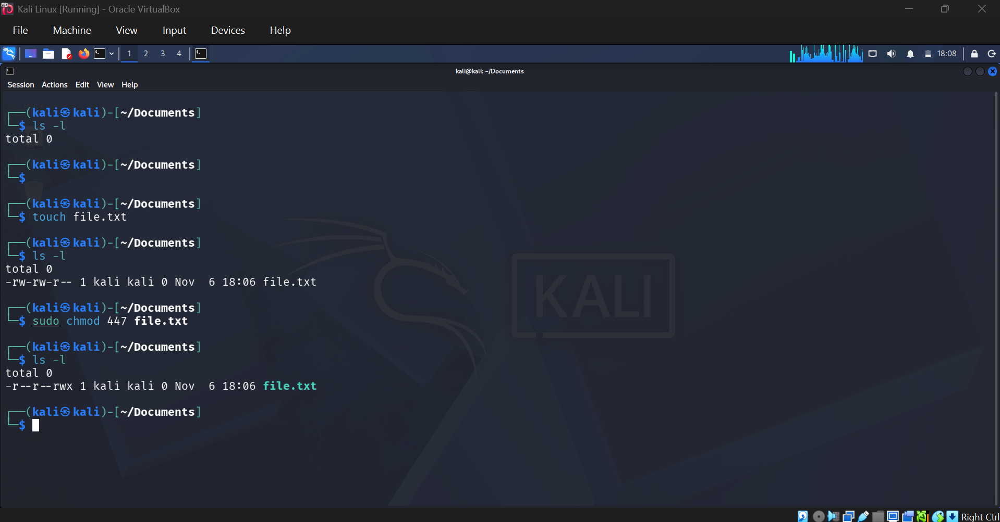
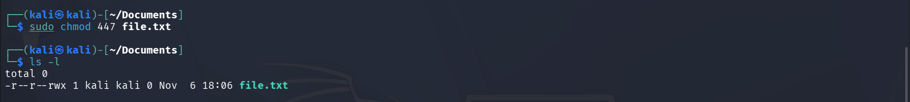
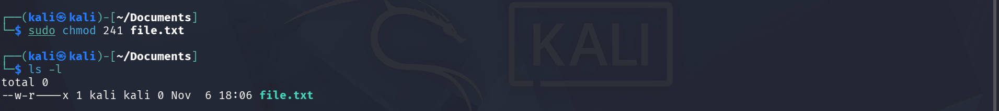
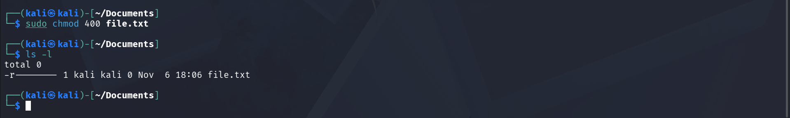
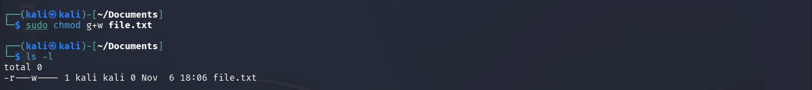
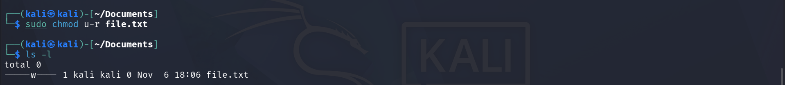
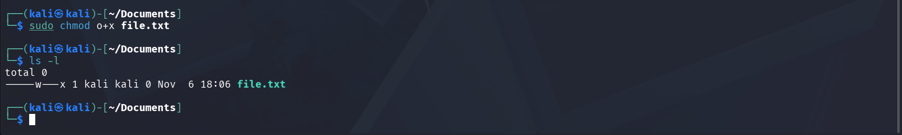
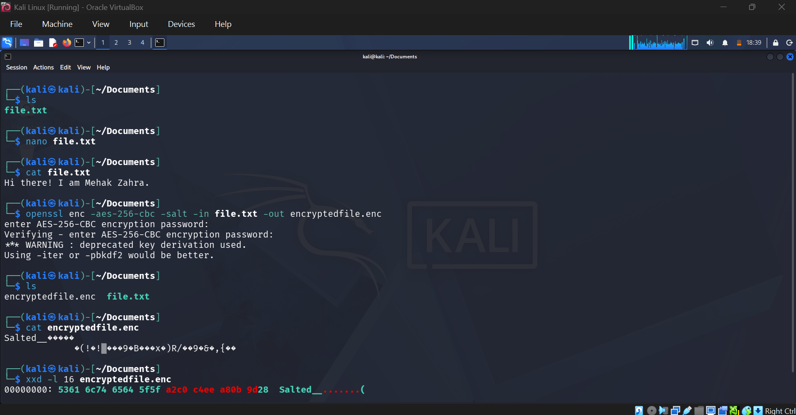

**ASSIGNMENT: 01**

**TRAINED BY: MR. WASEEM ABBAS KHAN**

**SUBMITTED BY: MEHAK ZAHRA**

**COHORT: PSEB-CYBER-ISB-02**

**DEADLINE: 08TH NOVEMBER, 2026**

**TASK: A (Malware Types & Examples)**

- Produce a table with one row per malware type. For each, give a real
  named example with the year, who it targeted, how it spread, and what
  it did.

| **Type** | **Definition** | **Named Example + Year** | **Target** | **How it Spread** | **Primary Impact** |
|----|:---|:---|:---|:---|:---|
| **Virus** | It is a type of malware that attaches itself to a file or program and makes copies of itself when the infected file or program is run. | CIH / Chernobyl (1998) | Computers running Windows 95 and Windows 98. \[1\] | Through infected executable (.exe) files. IBM also distributed Aptiva PCs infected with CIH in March 1999. \[1\] | Overwrote hard-drive data and attempted to corrupt the Flash BIOS, preventing computers from booting. \[1\] |
| **Worm** | It is a self-replicating type of malware that can spread from one computer to another without attaching itself to another file or program. | MyDoom (2004) | Infected computers running Microsoft Windows. Its DoS attacks targeted SCO Group and Microsoft, depending on the variant. \[2\] | Through infected email attachments and the Kazaa peer-to-peer (P2P) network. \[2\] | Opened a backdoor on infected computers and launched DoS attacks against SCO Group and, in some variants, Microsoft websites. \[2\] |
| **Trojan** | It is a type of malware that disguises itself as legitimate software to trick users into installing or running it. | Emotet (2014) | State and local governments, as well as organizations in the private and public sectors. \[3\] \[4\] | Through malicious spam emails containing infected attachments or links. It could also deliver additional malware after infection. \[3\] | Stole financial credentials and downloaded additional malware, including banking Trojans and ransomware. \[3\] |
| **Ransomware** | It is a type of malware that encrypts a victim’s files or locks their system and demands a ransom to restore access. | WannaCry (2017) | Organizations using unpatched or unsupported Windows operating systems, including the UK's NHS. \[5\] | By exploiting the EternalBlue vulnerability in Microsoft Windows to spread across networks. \[5\] \[6\] | Encrypted files, disrupted computer systems and demanded ransom payments to restore access. \[5\] |
| **Spyware** | It is a type of malware that secretly monitors a user's activities and collects information from their device. | Pegasus (2016) | UAE activist Ahmed Mansoor was targeted in 2016. Later campaigns also targeted Catalan politicians, journalists and civil society members. \[7\] \[8\] | Initially through malicious SMS links exploiting three iOS zero-day vulnerabilities (Trident). Later campaigns also used zero-click exploits. \[7\] \[8\] | Stole messages, recorded calls, tracked movements, accessed photos and secretly activated the camera and microphone. \[7\] |
| **Adware** | It is software that displays unwanted advertisements on a user's device, often to generate revenue. | Fireball (2017) | Computers worldwide, particularly in India (10.1%) and Brazil (9.6%). Around 20% of corporate networks were affected. \[9\] | Through software bundling, where it was installed alongside other software. \[9\] | Hijacked browsers, changed search engines and homepages, displayed advertisements and collected user information. \[9\] |
| **Rootkit** | It is a type of malware designed to hide its presence and help an attacker maintain privileged access to a system. | Sony BMG XCP Rootkit (2005) | Windows computers belonging to users who played Sony BMG copy-protected music CDs. \[10\] | Through Sony BMG music CDs containing Extended Copy Protection (XCP) software. \[10\] | Hid its presence, secretly monitored users' listening habits and created security vulnerabilities that exposed computers to attacks. \[10\] |
| **Keylogger** | It is a type of software or hardware that records the keys pressed on a keyboard, which may expose passwords and other sensitive information. | Olympic Vision (2016) | Key employees at companies in the US, Middle East and Asia. \[11\] | Through malicious emails disguised as messages from business partners, using spear-phishing and social engineering. \[11\] | Recorded keystrokes, took screenshots, stole login credentials and collected clipboard and system information. \[11\] |
| **Botnet Agent** | It is malicious software that infects a device and connects it to an attacker's command-and-control (C2) server, allowing the attacker to control the device remotely. | Mirai (2016) | Vulnerable IoT devices, including routers, IP cameras and digital video recorders. \[12\] \[13\] | By scanning the internet for vulnerable IoT devices and infecting them using common default login credentials, often through Telnet. \[13\] | Turned infected devices into bots to launch DDoS attacks. Mirai traffic was one source of the October 2016 attack on Dyn, disrupting access to websites such as Twitter, Netflix and GitHub. \[12\] \[14\] |
| **Fileless/ living-off-the-land** | It is malware that mainly uses a system's memory and legitimate system tools to carry out malicious activities, rather than relying on traditional files stored on disk. | Astaroth (2018) | Users and organizations, primarily in Brazil. \[15\] | Through spear-phishing emails containing malicious links that downloaded shortcut (LNK) files, which abused legitimate Windows tools. \[15\] | Stole credentials, keystrokes and clipboard data while abusing legitimate system tools to avoid detection. \[15\] |
| **Logic Bomb** | It is malicious code that remains inactive until a specific condition or event occurs, then performs its programmed action. | David Tinley / Siemens Logic Bomb (2014–2016) | Siemens Corporation, particularly its Monroeville, Pennsylvania location. \[16\] | The contractor secretly inserted malicious code into automated programs and spreadsheets. \[16\] | Caused programs to malfunction after specific dates, forcing Siemens to pay the contractor to fix them. \[16\] |
| **Bootkit** | It is a type of malware that infects or modifies the system's boot process so that malicious code can run before or during the loading of the operating system. | BlackLotus (2022) | Windows systems using UEFI Secure Boot with a vulnerable Windows boot manager. \[17\] | By exploiting the Baton Drop vulnerability (CVE-2022-21894) to bypass Secure Boot. It requires prior privileged or physical access. \[17\] | Bypassed Secure Boot, established persistence in the EFI System Partition (ESP) and disabled security features such as BitLocker and HVCI. \[17\] |

- Write three sentences on which type you think is most dangerous for a
  Pakistani SME and why?

<!-- -->

- For a Pakistani SME, ransomware can be especially dangerous because
  local businesses often have limited financial resources to pay the
  demanded ransom or recover their lost data. Many small and
  medium-sized businesses in Pakistan also lack sufficient funds and
  proper backup systems to protect their important business records. As
  a result, an attack could cause serious financial losses, disrupt
  daily operations, and potentially force a low- or middle-income
  business to shut down.

------------------------------------------------------------------------

**TASK: B (write ups)**

**B2:** Create a file, change its permissions three ways with chmod
(symbolic and octal), and explain what each change did.

- Right now, the permissions are set to 664, i.e read (4) and write (2)
  for user, read (4) and write (2) for group and read (4) only for
  others.

**Octal representation:**

- Now, the permissions are set to 447, i.e read (4) only for user,
  read (4) only for group and read (4), write (2) and execute (1) for
  others.

- Now, the permissions are set to 241, i.e write (2) only for user,
  read (4) only for group and execute (1) only for others.

- Now, the permissions are set to 400, i.e read (4) only for user,
  no (0) permission for group and no (0) permission for others.

**Symbolic representation:**

- The permissions are set to g+w (420) which means to give permission to
  group for writing.

- The permissions are set to u-r (020) which means to remove permission
  for user to read.

- The permissions are set to o+x (021) which means to give permission to
  others for executing.

------------------------------------------------------------------------

**B4:** Encrypt a file with OpenSSL, decode its header with xxd, and
explain what Salted\_\_ means?

**<u>Command for encryption:</u>**

“openssl enc -aes-256-cbc -salt -in file.txt -out encryptedfile.enc”

**<u>xxd command for decoding:</u>**

“xxd -l 16 encryptedfile.enc”

**<u>Header:</u>**

“00000000: 5361 6c74 6564 5f5f a2c0 c4ee a80b 9d28 Salted\_\_.......(”

**<u>Breakdown of Header:</u>**

1.  **First 8 bytes (53 61 6c 74 65 64 5f 5f):** These represent
    Salted\_\_ in ASCII, which is a marker used by OpenSSL to identify
    an encrypted file containing a salt.

2.  **Next 8 bytes (a2c0 c4ee a80b 9d28):** These are the actual random
    salt added during encryption.

3.  **Ciphertext:** After the 16-byte header, the encrypted data
    (ciphertext) begins.

4.  **Purpose of Salt:** OpenSSL uses the password and salt together to
    generate the encryption key and IV. Salt ensures that the same
    password produces different keys for different encryption
    operations.

5.  **Security Benefit:** Salt makes precomputed and rainbow-table
    attacks impractical because attackers would need separate
    precomputed tables for different salts. However, it does not
    completely prevent dictionary attacks.

------------------------------------------------------------------------

# References

| \[1\] | \[Online\]. Available: https://www.f-secure.com/v-descs/cih. |
|----|----|
| \[2\] | \[Online\]. Available: https://www.f-secure.com/v-descs/novarg. |
| \[3\] | \[Online\]. Available: https://www.justice.gov/opa/pr/emotet-botnet-disrupted-international-cyber-operation. |
| \[4\] | \[Online\]. Available: https://www.cisa.gov/news-events/alerts/2018/07/20/emotet-malware. |
| \[5\] | \[Online\]. Available: https://www.nao.org.uk/reports/investigation-wannacry-cyber-attack-and-the-nhs/. |
| \[6\] | \[Online\]. Available: https://www.cisa.gov/news-events/alerts/2017/05/12/indicators-associated-wannacry-ransomware. |
| \[7\] | \[Online\]. Available: https://citizenlab.org/2016/08/million-dollar-dissident-iphone-zero-day-nso-group-uae/. |
| \[8\] | \[Online\]. Available: https://citizenlab.org/2022/04/catalangate-extensive-mercenary-spyware-operation-against-catalans-using-pegasus-candiru/. |
| \[9\] | \[Online\]. Available: https://research.checkpoint.com/2017/fireball-chinese-malware-250-million-infection/. |
| \[10\] | \[Online\]. Available: https://www.ftc.gov/news-events/news/press-releases/2007/01/sony-bmg-settles-ftc-charges. |
| \[11\] | \[Online\]. Available: https://www.trendmicro.com/vinfo/us/security/news/cybercrime-and-digital-threats/olympic-vision-business-email-compromise-in-us-middle-east-and-asia. |
| \[12\] | \[Online\]. Available: https://blog.apnic.net/2016/10/26/quick-look-attack-dyn/. |
| \[13\] | \[Online\]. Available: https://www.cisa.gov/news-events/alerts/2016/10/14/heightened-ddos-threat-posed-mirai-and-other-botnets. |
| \[14\] | \[Online\]. Available: https://hub.dyn.com/dyn-blog/dyn-statement-on-10-21-2016-ddos-attack. |
| \[15\] | \[Online\]. Available: https://www.microsoft.com/en-us/security/blog/2019/07/08/dismantling-a-fileless-campaign-microsoft-defender-atp-next-gen-protection-exposes-astaroth-attack/. |
| \[16\] | \[Online\]. Available: https://www.justice.gov/usao-wdpa/pr/siemens-contract-employee-intentionally-damaged-computers-planting-logic-bombs-programs. |
|

------------------------------------------------------------------------
