**ASSIGNMENT: 05**

**TRAINED BY: MR. WASEEM ABBAS KHAN**

**SUBMITTED BY: MEHAK ZAHRA**

**COHORT: PSEB-CYBER-ISB-02**

**DEADLINE: 11TH NOVEMBER, 2026**

**TASK: A (SCOPE DOCUMENT)**

Write a scope and rules-of-engagement section for a hypothetical
\*.intel.com engagement, including the exclusions, the break-glass
clause and the emergency procedure.

**SCOPE AND RULES OF ENGAGEMENT**

<u>Hypothetical Web Application Penetration Test</u>: \*.intel.com

<u>Prepared by</u>: Mehak Zahra <u>Date</u>: 11/11/2026

**PART A: SCOPE**

1.  In Scope

- All subdomains matching \*.intel.com

- IP range: 203.0.113.0/24

- Public-facing APIs on the above domains

2.  Explicitly Out of Scope

- career.intel.com

- Any domain outside intel.com

- Third-party services linked to in-scope hosts

3.  Prohibited Techniques

- No denial-of-service or load testing

- No social engineering (phishing, vishing)

- No destructive actions

4.  Access Granted

- Two test accounts (standard user and administrator)

- VPN credentials and jump-server details supplied by the client

5.  Testing Window

2026-11-08 to 2026-11-11, 22:00-06:00 +0500

Night hours chosen because production systems may not tolerate
business-hours testing.

6.  Emergency Contact

<u>Contact</u>: Emma, +00 000 000 000

**PART B: RULES OF ENGAGEMENT**

1.  Written authorization is required before the first packet is sent.

2.  Test only what is listed in the scope.

3.  Data minimization: If customer records are found, prove access with
    one record and stop. Do not copy the database.

4.  No destructive actions unless explicitly authorized.

5.  Stop on critical finding and notify the client immediately.

6.  Report promptly. Findings must not be held until the end.

7.  Destroy test data afterwards and confirm in writing when and how.

**PART C: BREAK-GLASS CLAUSE**

The scope uses a wildcard, so new subdomains may appear during testing.
No new host may be tested until the named contact approves it in
writing. Every approval is recorded in the engagement log.

<u>Authorizing contact</u>: Marie Jones, Head of Application Security,
mariee.jones@example.com, +00 000 000 000

**PART D: EMERGENCY PROCEDURE**

If testing causes an outage, instability, or exposes sensitive data:

1)  Stop all testing immediately.

2)  Call the emergency contact.

3)  Email the security lead with time, target and last actions taken.

4)  Do not try to fix or undo anything.

5)  Resume only after written instructions from the client.

**PART E: EXCLUSIONS**

<u>Excluded</u>: career.intel.com, all domains outside intel.com,
third-party services linked to in-scope hosts, denial-of-service, social
engineering and destructive actions (see Part A).

------------------------------------------------------------------------

**TASK: B (DORK REPORT)**

Find six exposures on a domain you are authorized to test (your own,
your employer's, or a public domain you are not attacking) and document
each dork, its result and the fix.

**<u>Target domain</u>**: vulnweb.com (public test site)

**<u>Method</u>**: Google search results only.

- **Exposure \#1**

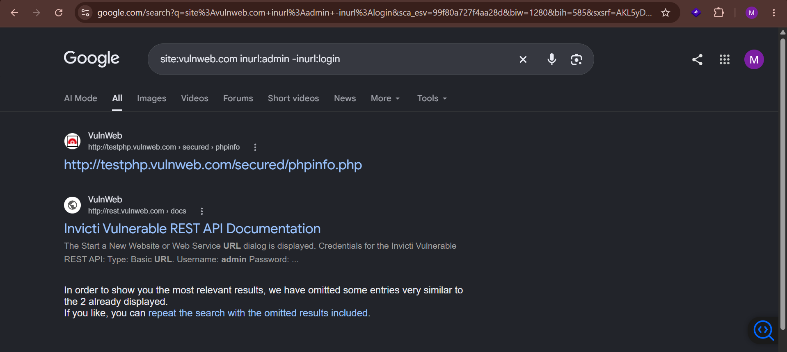

**<u>Dork</u>:**

site:vulnweb.com inurl:admin -inurl:login

**<u>Operators</u>:**

- site: limits the search to the vulnweb.com domain.

- inurl: finds pages with "admin" in their URL.

- -inurl: excludes URLs containing "login".

**<u>Result</u>:**

------------------------------------------------------------------------

Google showed testphp.vulnweb.com/secured/phpinfo.php and the
rest.vulnweb.com/docs page. The search snippet on the documentation page
also showed REST API login details (Basic authentication, username
"admin").

------------------------------------------------------------------------

**<u>Risk</u>:**

------------------------------------------------------------------------

The phpinfo page reveals PHP version, settings, loaded modules and
server paths. The login details shown in public search results may allow
others to access the API.

------------------------------------------------------------------------

**<u>Fix</u>:**

------------------------------------------------------------------------

Delete phpinfo.php from the live server or allow access only from
trusted IP addresses. Remove login details from public documentation and
change the exposed credentials. Also, add noindex and request Google to
remove the page through Search Console.

------------------------------------------------------------------------

------------------------------------------------------------------------

- **Exposure \#2**

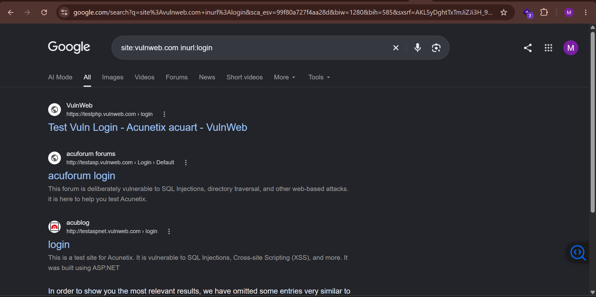

**<u>Dork</u>:**

site:vulnweb.com inurl:login

**<u>Operators</u>:**

- site: limits the search to the vulnweb.com domain.

- inurl: finds pages with "login" in their URL.

**<u>Result</u>:**

Google found login pages on three hosts: testphp (Test Vuln Login),
testasp (acuforum login) and testaspnet (acublog login). The search
snippets show that the forum has SQL injection and directory traversal
weaknesses, while the blog mentions SQL injection and Cross-Site
Scripting (XSS). The blog is built using ASP.NET.

**<u>Risk</u>:**

These login pages are visible in Google search results, making them easy
to find. The snippets also reveal information about the applications and
their weaknesses, which may help attackers target them.

**<u>Fix</u>:**

Add noindex or X-Robots-Tag to login pages to keep them out of search
results. Use rate limiting, account lockout and MFA to protect login
pages. Avoid showing sensitive information in page descriptions or
search snippets.

------------------------------------------------------------------------

- **Exposure \#3**

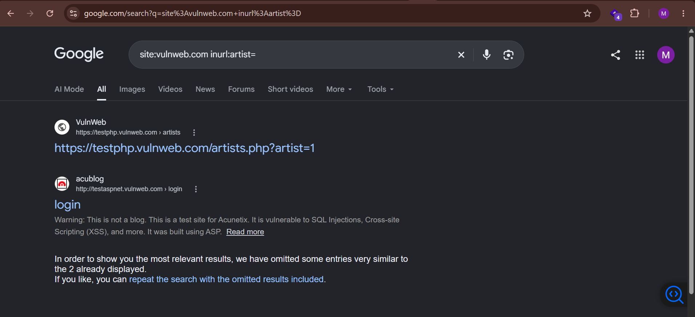

**<u>Dork</u>:**

site:vulnweb.com inurl:login

**<u>Operators</u>:**

- site: limits the search to the vulnweb.com domain.

- inurl: finds pages with "login" in their URL.

**<u>Result</u>:**

Login pages were found on three hosts: testphp (Test Vuln Login),
testasp (acuforum login) and testaspnet (acublog login). The search
snippets show that the forum is vulnerable to SQL injection and
directory traversal, while the blog mentions SQL injection and
Cross-Site Scripting (XSS). The blog is built using ASP.NET.

**<u>Risk</u>:**

These indexed login pages make it easier for attackers to find login
endpoints. The search snippets also reveal information about the
applications and their known weaknesses, which may help attackers target
them.

**<u>Fix</u>:**

Add noindex or X-Robots-Tag to login pages to prevent them from
appearing in search results. Use rate limiting, account lockout and MFA
to protect login pages. Avoid showing sensitive information in page
descriptions or search snippets.

------------------------------------------------------------------------

- **Exposure \#4**

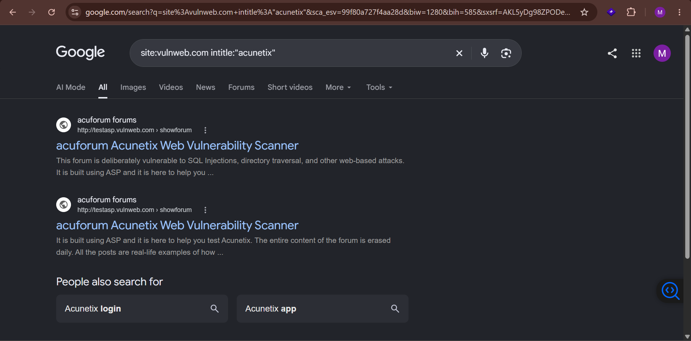

**<u>Dork:</u>**

site:vulnweb.com intitle:"acunetix"

**<u>Operators</u>:**

- site: limits the search to the vulnweb.com domain.

- intitle: finds pages with "acunetix" in their title.

**<u>Result</u>:**

Google found two acuforum pages on testasp.vulnweb.com/showforum. Their
titles show the scanner name, and the snippets mention that the forum is
vulnerable to SQL injection and directory traversal. They also show that
the forum is built using ASP.

**<u>Risk</u>:**

The page titles and search snippets reveal the software name and its
weaknesses. Attackers can get this information without directly
accessing the server.

**<u>Fix</u>:**

Remove product names and vulnerability details from page titles and
descriptions. Protect test and staging sites with login access and add
noindex to prevent them from appearing in search results.

------------------------------------------------------------------------

- **Exposure \#5**

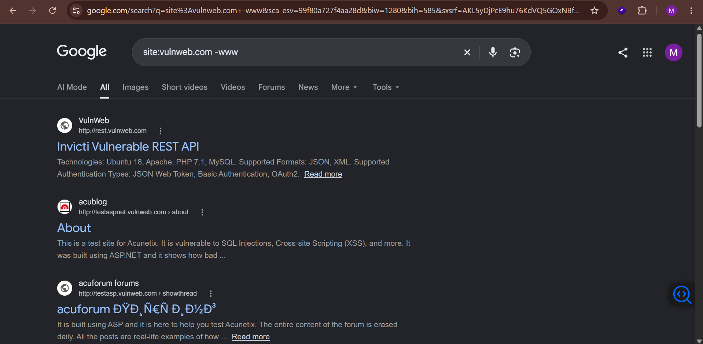

**<u>Dork</u>:**

site:vulnweb.com -www

**<u>Operators</u>:**

- site: limits the search to the vulnweb.com domain.

- \- excludes "www", so Google shows other subdomains.

**<u>Result</u>:**

Google showed rest.vulnweb.com (Invicti Vulnerable REST API),
testaspnet.vulnweb.com (acublog) and testasp.vulnweb.com (acuforum). The
search snippets revealed Ubuntu 18, Apache, PHP 7.1, MySQL and supported
authentication methods (JWT, Basic Auth and OAuth2).

**<u>Risk</u>:**

An attacker can find subdomains and learn about the technologies used
without directly accessing the server. Ubuntu 18 and PHP 7.1 are
outdated versions and may have known security weaknesses.

**<u>Fix</u>:**

Remove unused subdomains, prevent non-public pages from appearing in
search results, hide software version details from pages and headers,
and update outdated software.

------------------------------------------------------------------------

- **Exposure \#6**

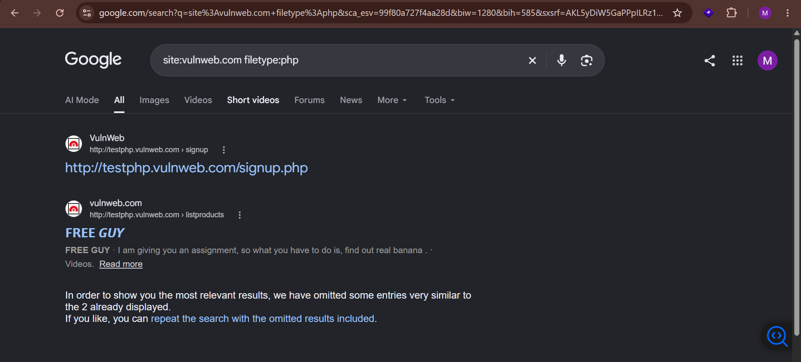

**<u>Dork</u>:**

site:vulnweb.com filetype:php

**<u>Operators</u>:**

- site: limits the search to the vulnweb.com domain.

- filetype: shows results that are PHP files.

**<u>Result</u>:**

Google found testphp.vulnweb.com/signup.php and the listproducts page of
the same application.

**<u>Risk</u>:**

These PHP pages reveal information about the website structure and
technology. Signup and product listing pages also accept user input,
which may create security risks if not properly checked.

**<u>Fix</u>:**

Hide file extensions using URL rewriting and prevent test and dynamic
pages from appearing in search results by adding noindex. Also, check
user input properly and use a Web Application Firewall (WAF) for extra
protection.

------------------------------------------------------------------------

**TASK: C (SUBDOMAIN RECONCILIATION)**

Enumerate subdomains of one domain with three tools. Present a single
deduplicated list, state which tool found what no other found, and
explain why?

**NOTE: Only passive enumeration was performed on hackerone.com. No
active scanning or resolution.**

**ENUMERATION:**

1.  Subfinder

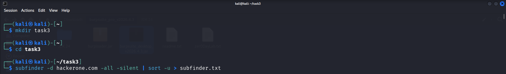

The subfinder command was used to discover subdomains of hackerone.com.
The -all option enabled all available sources, while -silent suppressed
extra output. The sort -u command removed duplicate entries and saved
the results in subfinder.txt.

2.  Assetfinder

The assetfinder command was used to find subdomains of hackerone.com.
The --subs-only option displayed only subdomains, while sort -u removed
duplicates and saved the results in assetfinder.txt.

3.  theHarvester

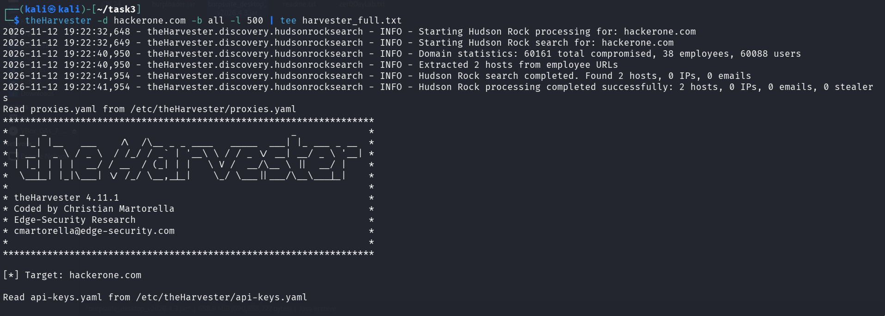

The theHarvester command collected information from multiple sources
using -b all. Its output included hostnames, email addresses and IP
addresses. The output was saved in harvester_full.txt using tee.

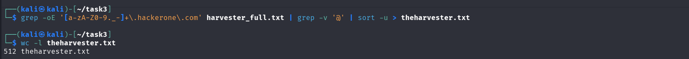

A filtering command was then used to extract hostname entries belonging
to hackerone.com, exclude email-containing entries, remove duplicates
and save the cleaned results in theharvester.txt.

**DEDUPLICATED LIST:**

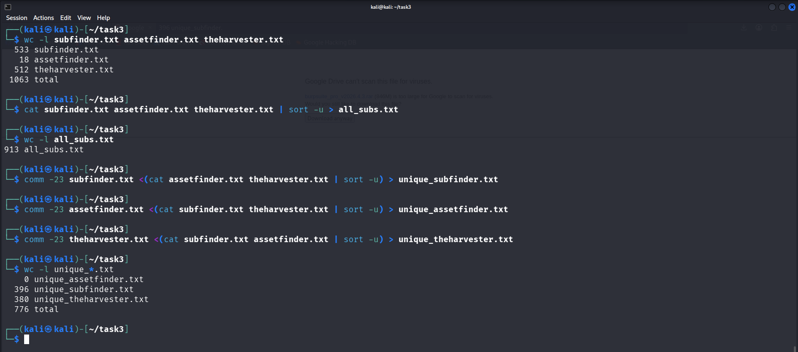

**\> wc -l subfinder.txt assetfinder.txt theharvester.txt**

<u>Explanation</u>: This command counted the total number of subdomains
collected by each tool.

<u>Findings</u>:

- Subfinder: 533

- Assetfinder: 18

- theHarvester: 512

- Total entries: 1063

**\> cat subfinder.txt assetfinder.txt theharvester.txt \| sort -u \>
all_subs.txt**

<u>Explanation:</u> The cat command combined the three output files,
while sort -u removed duplicate hostnames. The final results were saved
in all_subs.txt.

**\> wc -l all_subs.txt**

<u>Explanation</u>: This command counted the total number of unique
subdomains in the combined list.

<u>Finding</u>: 913 unique subdomains.

**\> comm -23 subfinder.txt \<(cat assetfinder.txt theharvester.txt \|
sort -u) \> unique_subfinder.txt**

<u>Explanation</u>: This command compared Subfinder's results with the
results of the other two tools and saved only the subdomains found
exclusively by Subfinder.

\> **comm -23 assetfinder.txt \<(cat subfinder.txt theharvester.txt \|
sort -u)**

**unique_assetfinder.txt**

<u>Explanation</u>: This command compared Assetfinder's results with the
other two tools and saved only its exclusive subdomains.

**\> comm -23 theharvester.txt \<(cat subfinder.txt assetfinder.txt \|
sort -u) \>**

**unique_theharvester.txt**

<u>Explanation</u>: This command compared theHarvester's results with
the other two tools and saved only its exclusive subdomains.

**\> wc -l unique\_\*.txt**

<u>Explanation</u>: This command counted the exclusive subdomains
discovered by each tool.

<u>Findings</u>:

- Unique_Subfinder: 396

- Unique_Assetfinder: 0

- Unique_theHarvester: 380

- Total entries: 776

------------------------------------------------------------------------

**COMPARISON:**

The results obtained from the three tools were compared to identify
subdomains that were discovered exclusively by one tool and not found by
the other two tools.

|   **Tool**   | **Total Discovered** | **Unique Subdomain** |
|:------------:|:--------------------:|:--------------------:|
|  Subfinder   |         533          |         396          |
| Assetfinder  |          18          |          0           |
| theHarvester |         512          |         380          |

<u>Tool-specific findings</u>:

- <u>Subfinder</u>: Discovered 396 subdomains that were not found by
  theHarvester or Assetfinder.

- <u>Assetfinder</u>: Discovered 0 exclusive subdomains. All 18 results
  were also found by the other tools.

- <u>theHarvester</u>: Discovered 380 subdomains that were not found by
  Subfinder or Assetfinder.

------------------------------------------------------------------------

**EXPLANATION:**

The three tools produced different results because they use different
data sources and enumeration techniques. According to their
documentation:

- <u>Subfinder</u>: Uses multiple passive online sources and APIs for
  subdomain discovery. Different source coverage can result in
  additional unique findings \[1\].

- <u>Assetfinder</u>: Uses various public sources, including crt.sh,
  CertSpotter, HackerTarget, ThreatCrowd and Wayback Machine, to
  discover domains and subdomains \[2\].

- <u>theHarvester</u>: Collects information from search engines,
  Certificate Transparency logs, DNS datasets, code repositories and
  other OSINT sources. Some sources require API keys, which can affect
  results \[3\].

**Conclusion:** The results differed because each tool uses different
data sources and collection methods. Subfinder and theHarvester
discovered exclusive subdomains, while Assetfinder's results overlapped
with the other two tools.

------------------------------------------------------------------------

# **References**

<table>
<colgroup>
<col style="width: 3%" />
<col style="width: 96%" />
</colgroup>
<thead>
<tr>
<th>
[1]
</th>
<th>
"GitHub," [Online]. Available:

https://github.com/projectdiscovery/subfinder.
</th>
</tr>
</thead>
<tbody>
<tr>
<td>
[2]
</td>
<td>
"GitHub," [Online]. Available:
https://github.com/tomnomnom/assetfinder/blob/master/README.md.
</td>
</tr>
<tr>
<td>
[3]
</td>
<td>
"GitHub," [Online]. Available:
https://github.com/laramies/theHarvester/blob/master/README.md?plain=1.
</td>
</tr>
</tbody>
</table>

------------------------------------------------------------------------

**TASK: D (SCANNER COMPARISON)**

Run ZAP and Burp against the same target. Compare the findings: which
did each find that the other missed, and why.

- First, check the target is accessible.

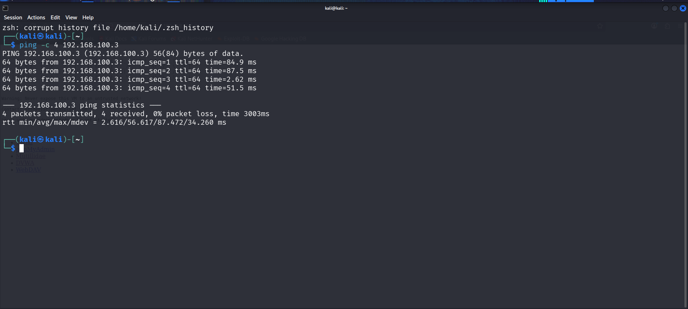

- Now open the target in browser.

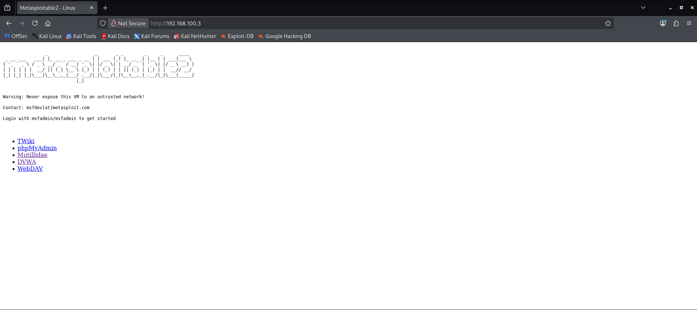

1.  **OWASP ZAP**

- Open the owasp zap to start scanning the target.

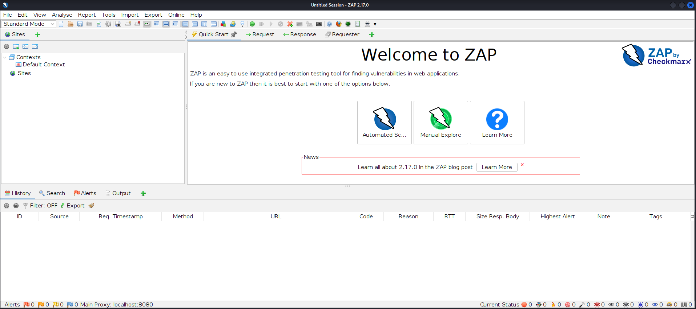

- Select automated scanning and give URL of the target and click on
  “Attack”.

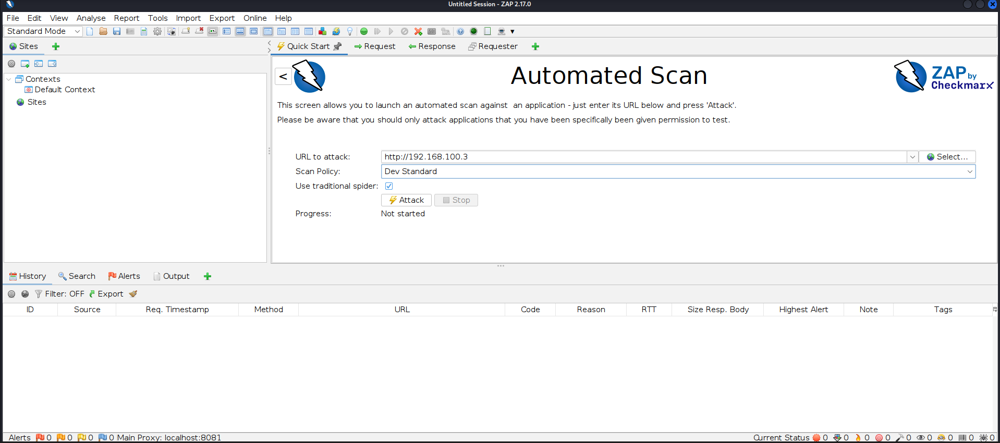

- After completing the scanning, it shows all the vulnerabilities found
  in the target with risk level: high, medium, low, information

1.  Apache HTTP Server Vulnerability

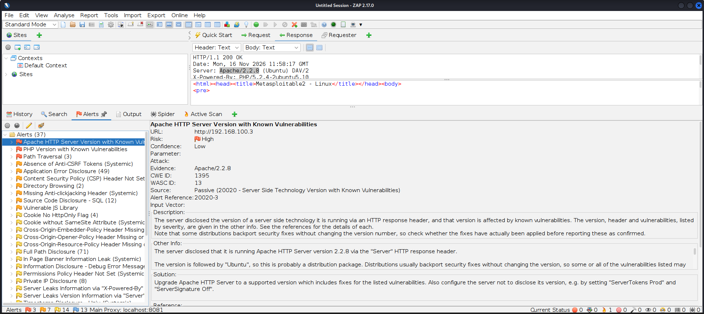

2.  PHP Version Vulnerability

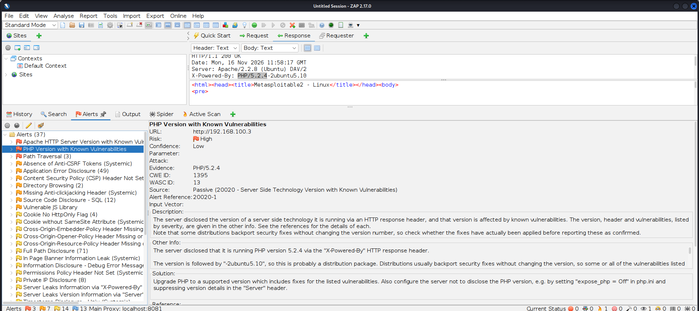

3.  Path Traversal

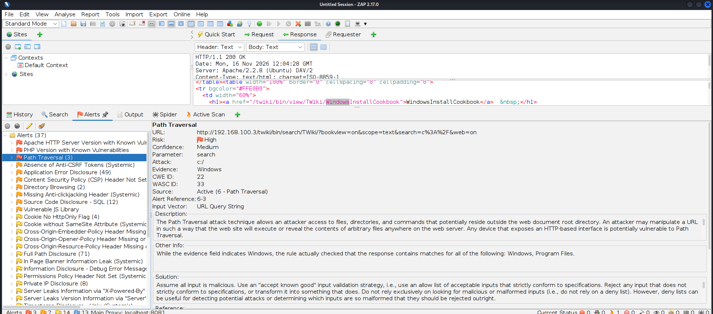

------------------------------------------------------------------------

2.  **BURP SUITE**

- Open the burp suite and open its browser to access the target.

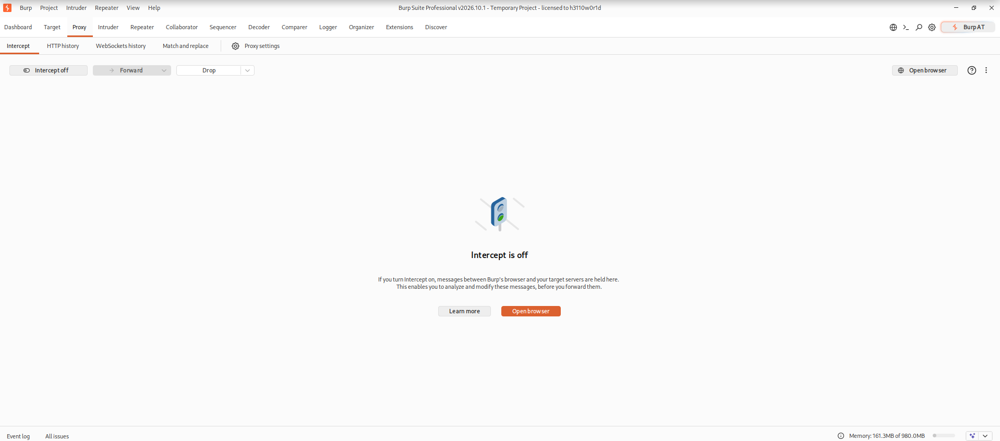

- Navigate to http proxy where we can find all the requests.

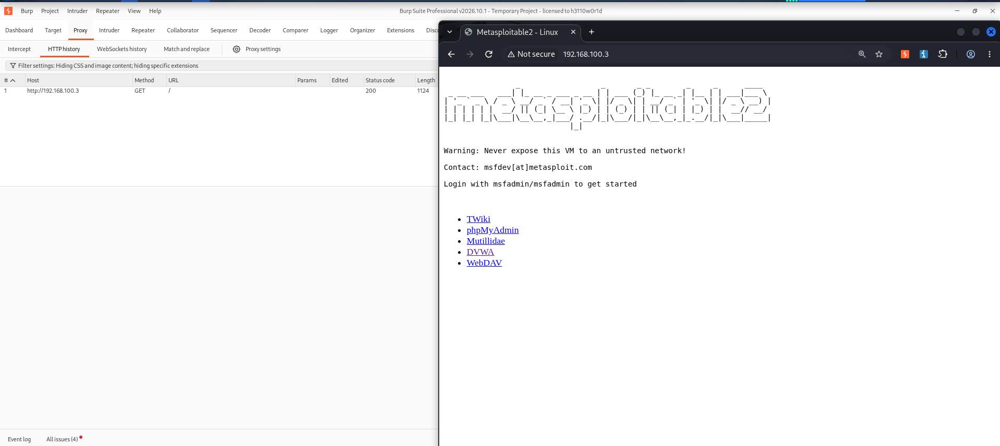

- Now randomly move throughout the target to get requests inside burp
  suite.

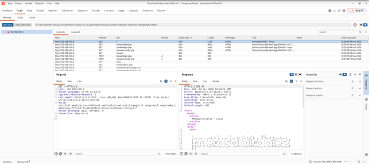

- Now from dashboard, click on “New Scan” to start “Crawl and Audit”
  option. Fill in the details and then start scanning.

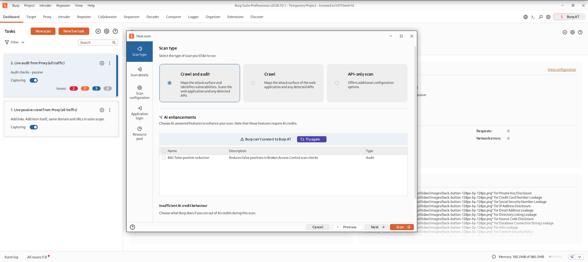

- After completion, it shows all the results on dashboard, what it
  found.

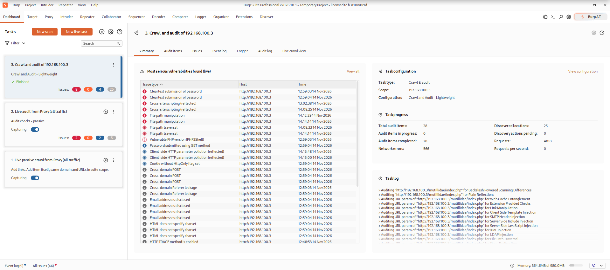

- Select any vulnerability to check its details.

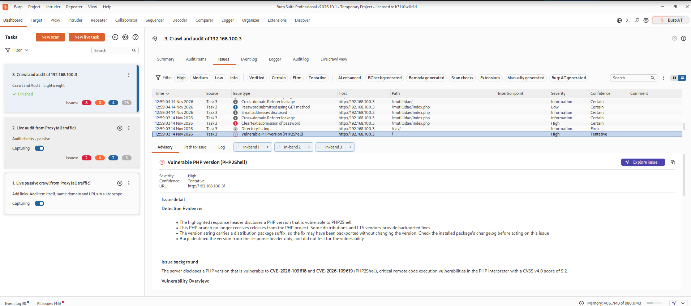

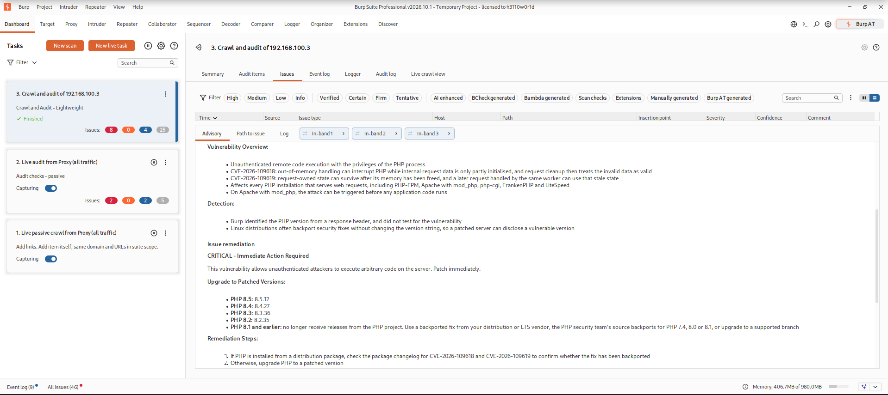

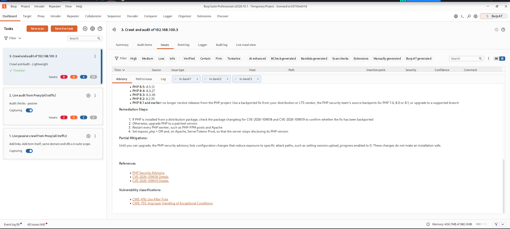

- Now send some requests of your choice to the repeater and make changes
  to observe result before and after each change.

- For example, here home page is sent to repeater.

**<u>Before</u>**:

- Security level is set to low.

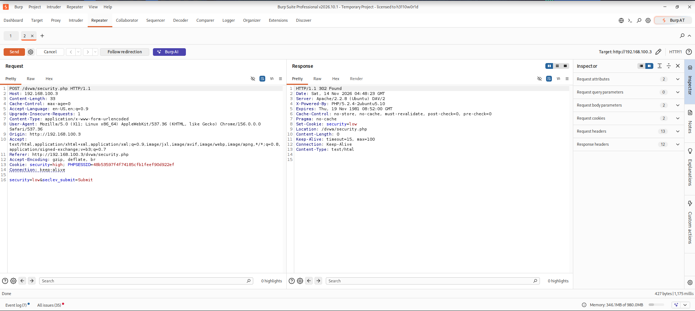

**<u>After</u>**:

- Security level is set to high. It found the page and it completed the
  change in response being made in request.

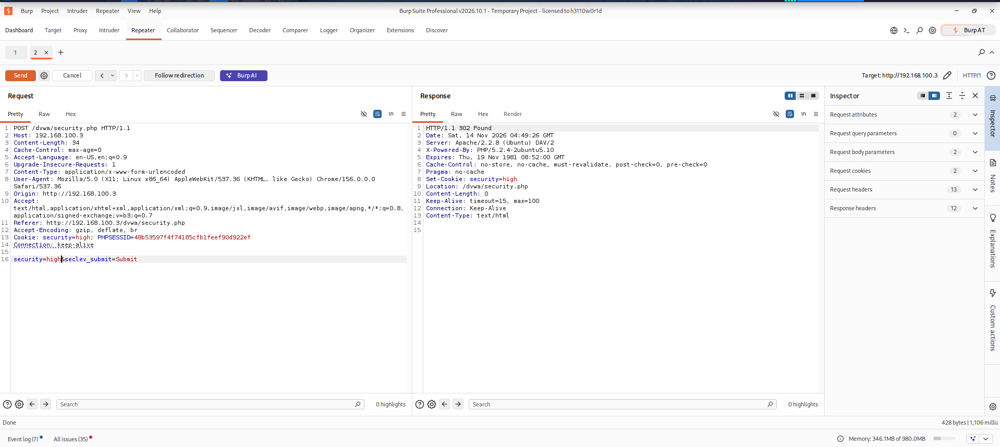

Now we selected the second page i.e. login page.

**<u>Before</u>**:

- The username and password are set to ‘admin’ and ‘password’
  respectively. It redirected to the index page that means the
  credentials were correct and we were able to login and access. As seen
  in response tab that Location: index.php

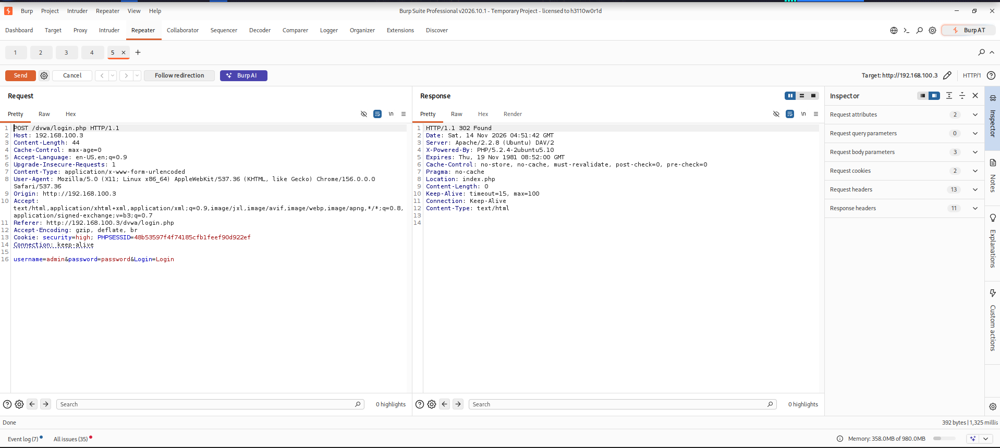

**<u>After</u>**:

- After changing the username and password from ‘admin’ and ‘password’
  to ‘admin’ and ‘test123’ respectively, it redirected to the same page,
  as seen by location: login.php, to re-enter the credentials because
  they were wrong.

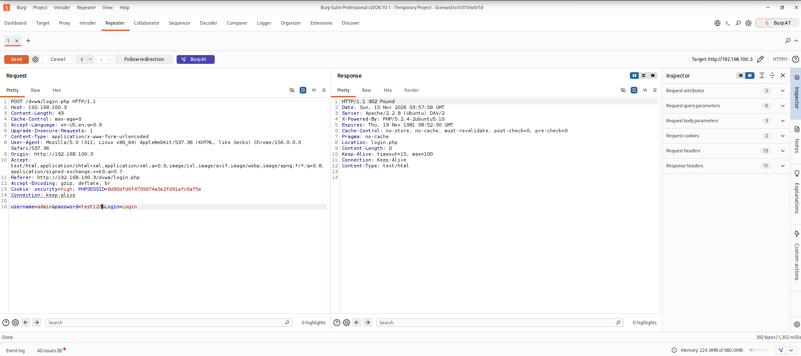

- **Scanning Results**

Both tools were used to scan the same target:

“http://192.168.100.3/”

The following results were obtained:

|  **Severity**   | **ZAP** | **Burp Suite** |
|:---------------:|:-------:|:--------------:|
|    **High**     |    3    |       3        |
|   **Medium**    |    7    |       0        |
|     **Low**     |   14    |       2        |
| **Information** |   13    |       16       |
|    **Total**    | **37**  |     **21**     |

- **Findings of OWASP ZAP**

OWASP ZAP reported the following three High severity findings:

1.  Path Traversal

2.  PHP Server Vulnerability

3.  Apache HTTP Server Version with Known Vulnerabilities

These findings indicate possible security weaknesses in the target web
application and its server configuration.

- **Findings of Burp Suite**

Burp Suite reported the following two High severity findings:

1.  Cleartext Submission of Password

2.  Vulnerable PHP2Shell

3.  Cross Site Scripting (Reflected)

- **Comparison and Analysis**

OWASP ZAP and Burp Suite detected different vulnerabilities because both
tools use different scanning techniques, detection rules, and testing
methods. ZAP identified Path Traversal, PHP Server Vulnerability, and
Apache HTTP Server Version with Known Vulnerabilities, while Burp Suite
identified Cleartext Submission of Password, Vulnerable PHP2Shell, and
Cross-Site Scripting (Reflected). Although both tools reported three
High severity findings, the vulnerabilities detected by each tool were
different. This shows that using both tools can help identify a wider
range of security issues in a web application.

- **Conclusion**

Both OWASP ZAP and Burp Suite successfully identified security issues in
the target web application. Their results showed that using more than
one security testing tool can provide better coverage and help discover
vulnerabilities that may not be identified by a single tool.

------------------------------------------------------------------------
