**ASSIGNMENT: 02**

**TRAINED BY: MR. WASEEM ABBAS KHAN**

**SUBMITTED BY: MEHAK ZAHRA**

**COHORT: PSEB-CYBER-ISB-02**

**DEADLINE: 08TH NOVEMBER, 2026**

**TASK: A**

Select three findings from your own scan of Metasploitable 2 and
document each one in full. Choose findings from different categories
where possible.

1.  Remote Code Execution (vsftpd 2.3.4 — CVE-2011-2523)

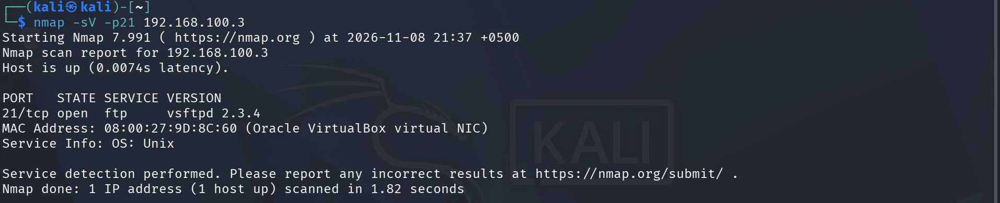

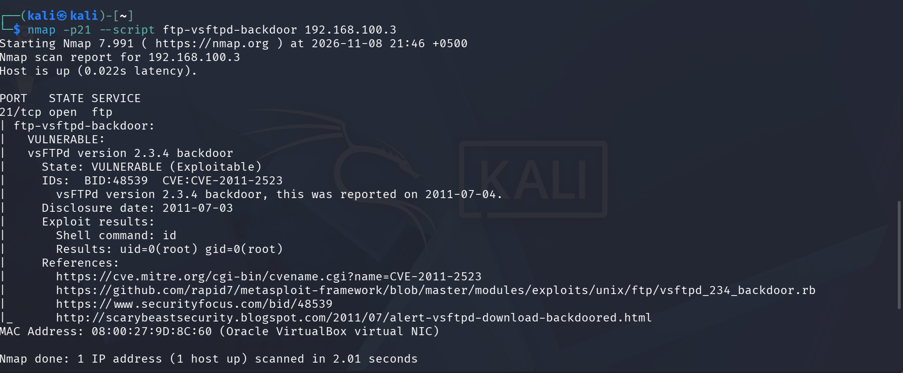

**TITLE:** FTP Backdoor Command Execution in vsftpd 2.3.4

**SEVERITY:** 9.8 Critical CVSS:3.1/AV:N/AC:L/PR:N/UI:N/S:U/C:H/I:H/A:H

**ASSET:** 192.168.100.3:21/tcp vsftpd 2.3.4

**IDENTIFIERS:** CVE-2011-2523 \| CWE-78

**DESCRIPTION:**

The distributed vsftpd 2.3.4 archive contained a backdoor that opens a
command shell on port 6200/tcp when a username containing a specific
character sequence is supplied. The compromised archive was available
for approximately three days in 2011.

**EVIDENCE:**

nmap -sV -p21 192.168.100.3 -\> vsftpd 2.3.4

nmap -p21 --script ftp-vsftpd-backdoor -\> reports VULNERABLE

Scan performed 2026-11-08 21:37 +0500

**PROOF OF CONCEPT:**

Step 1: Run the Nmap vulnerability detection script to test the vsftpd
2.3.4 backdoor:

nmap -p21 --script ftp-vsftpd-backdoor 192.168.100.3

Step 2: The scan reports the target as VULNERABLE (Exploitable) and
successfully executes the id command.

Step 3: Verify the command execution result. The output uid=0(root)
gid=0(root) confirms that the command was executed with root-level
privileges.

**IMPACT:** Unauthenticated remote code execution as the FTP service
account, on a host that also provides database services.

**REMEDIATION:** Upgrade vsftpd to the current release. Verify vendor
signatures.

**REFERENCES:**

<https://security-tracker.debian.org/tracker/CVE-2011-2523>

<https://access.redhat.com/security/cve/cve-2011-2523>

------------------------------------------------------------------------

2.  Information disclosure (Exposed /phpinfo.php)

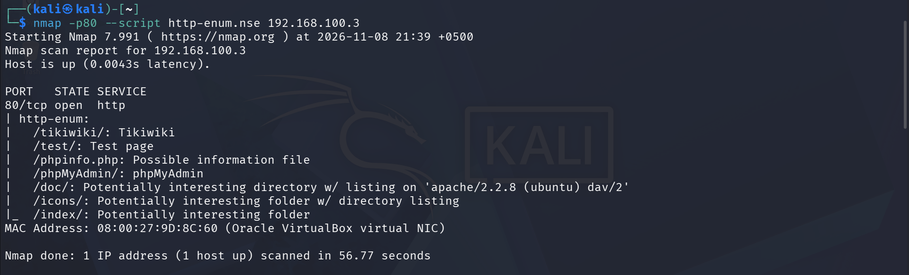

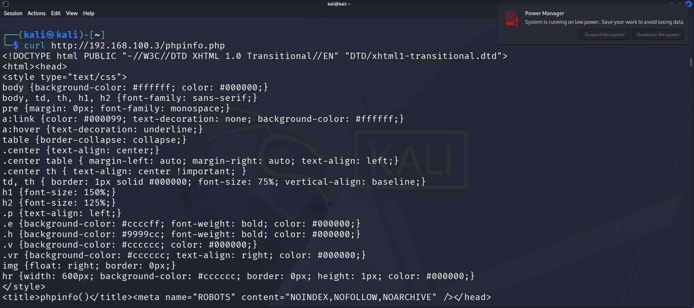

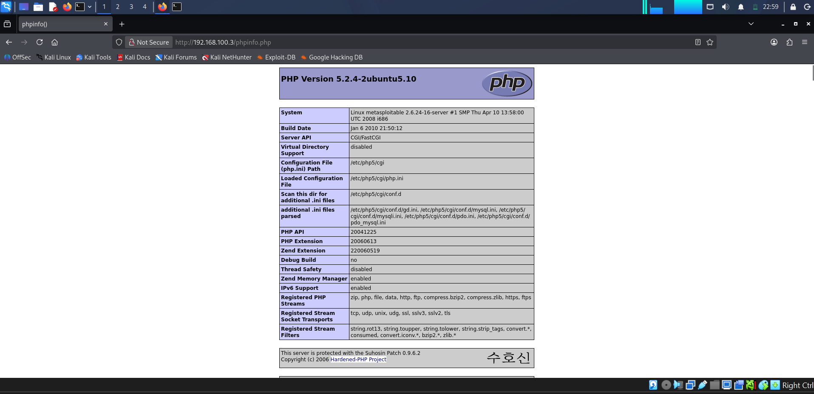

**TITLE:** Exposure of Sensitive Information to an Unauthorized Actor

**SEVERITY:** 8.8 High
CVSS:4.0/AV:N/AC:L/AT:N/PR:N/UI:N/VC:L/VI:L/VA:H/SC:N/SI:N/SA:N

**ASSET:** 192.168.100.3:80/tcp Apache httpd

**IDENTIFIERS:** CVE-2024-12142 \| CWE-200

**DESCRIPTION:**

The web server at 192.168.100.3 exposes a phpinfo.php page, discovered
via nmap http-enum enumeration, which is publicly accessible without
authentication. This page reveals detailed PHP configuration data,
including software versions, server file paths, and environment
variables, which can assist an attacker in identifying further attack
vectors on the host.

**EVIDENCE:**

nmap -p80 --script http-enum.nse 192.168.100.3

curl -I http://192.168.100.3/phpinfo.php -\> reports ACCESSIBLE

Scan performed 2026-11-08 21:39 +0500

**PROOF OF CONCEPT:**

Step 1: Enumerate web directories using Nmap: nmap -p80 --script
http-enum 192.168.100.3

Step 2: Check whether the phpinfo.php page is accessible: curl -I
http://192.168.100.3/phpinfo.php

Step 3: Retrieve the PHP configuration page: curl
http://192.168.100.3/phpinfo.php

Step 4: Open the following URL in a web browser:
http://192.168.100.3/phpinfo.php

Step 5: Observe the exposed PHP configuration details, including PHP
version, server information, system details, and configuration settings.
This demonstrates information disclosure through an publicly accessible
phpinfo page.

**IMPACT:** Exposure of sensitive PHP configuration details, including
server information and environment settings, to unauthenticated users.

**REMEDIATION:** Remove or restrict public access to phpinfo.php.
Disable unnecessary PHP information disclosure and review exposed
configuration details.

**REFERENCES:**

<https://nvd.nist.gov/vuln/detail/cve-2024-12142>

<https://github.com/advisories/GHSA-4qpq-7frv-mpfw>

------------------------------------------------------------------------

3.  **Misconfiguration (Anonymous FTP)**

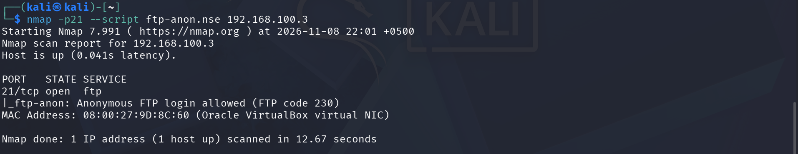

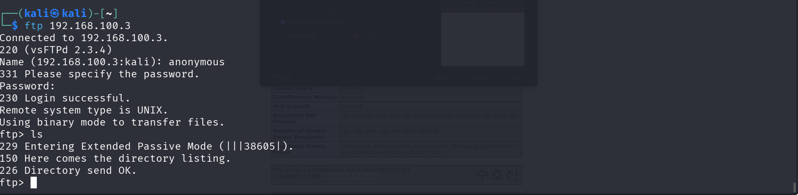

**TITLE:** Improper Authentication bypass

**SEVERITY:** 8.8 High CVSS:3.1/AV:A/AC:L/PR:N/UI:N/S:U/C:H/I:H/A:H

**ASSET:** 192.168.100.3:21/tcp FTP (Anonymous Access)

**IDENTIFIERS:** CVE-2023-25556 \| CWE-287

**DESCRIPTION:**

The FTP service (vsftpd) running on 192.168.100.3 permits anonymous
login, allowing any unauthenticated user who can reach port 21 to access
the FTP directory without valid credentials. This is a configuration
weakness rather than a software defect.

**EVIDENCE:**

nmap -p21 --script ftp-anon.nse 192.168.100.3

-\> opens means VULNERABLE

Scan performed 2026-11-08 22:01 +0500

**PROOF OF CONCEPT:**

Step 1: Scan FTP service using Nmap to identify anonymous login
permissions: nmap -p21 --script ftp-anon.nse 192.168.100.3

Step 2: Connect to the FTP server: ftp 192.168.100.3

Step 3: Attempt login using the username anonymous with an empty
password.

Step 4: If login is successful, execute the ls command to list
accessible files and directories.

Step 5: Record the results as evidence of anonymous FTP access and any
files accessible without authentication.

**IMPACT:** Unauthenticated users may access exposed FTP files,
potentially resulting in unauthorized disclosure or download of
sensitive information.

**REMEDIATION:** Disable anonymous FTP access. Require authenticated
users and enforce appropriate file permissions and access controls.

**REFERENCES:**

<http://nvd.nist.gov/vuln/detail/cve-2025-59980>

<https://github.com/advisories/GHSA-2r3j-v23v-hx4j>

------------------------------------------------------------------------

**TASK: B**

**B1:** Run host discovery with nmap, netdiscover and ipscan and explain
any difference in results.

1.  nmap

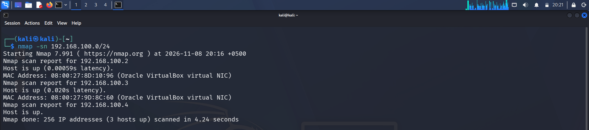

2.  netdiscover

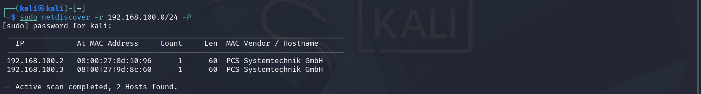

3.  ipscan

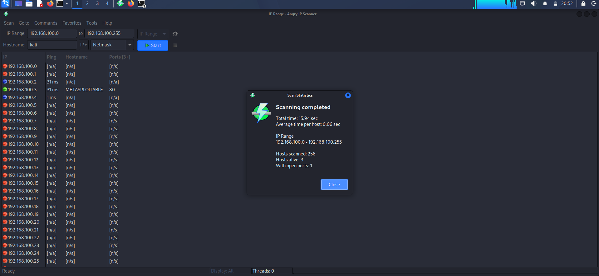

Three tools were used to identify live hosts on the 192.168.100.0/24
subnet. Nmap sent ping requests to every IP address and found 3 active
hosts. Angry IP Scanner also detected the same 3 hosts and identified
one as METASPLOITABLE with port 80 open. Netdiscover works differently
because it listens for ARP packets instead of sending its own requests.
In passive mode, it only detects ARP traffic occurring at that moment,
so it found 2 hosts only. When multiple tools produce the same results,
the findings are more reliable. Differences in results may occur due to
the limitations or working methods of individual tools.

------------------------------------------------------------------------

**B2:** Scan the same 100 ports with -T0 and -T5; record timings and
compare results.

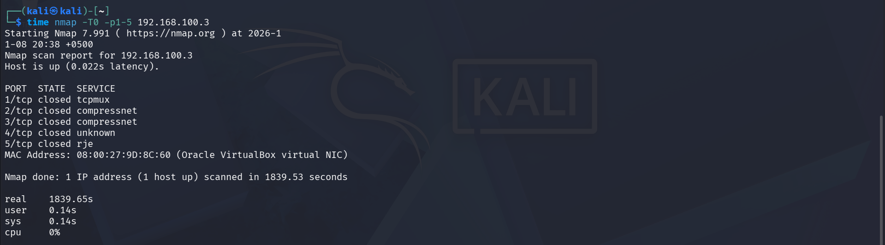

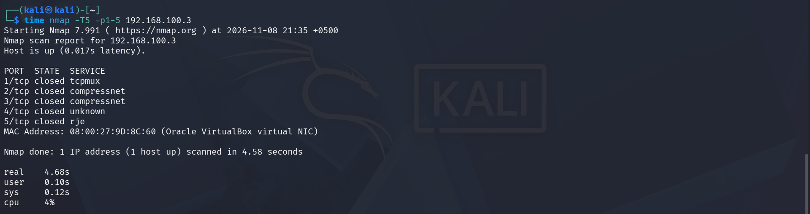

**RESULTS AND COMPARISON:**

The Nmap scan was performed using two different timing templates, T0
(Paranoid) and T5 (Insane), on the same target.

- **T0 Scan:** Took 1839.53 seconds (approximately 30 minutes and 40
  seconds) to complete.

- **T5 Scan:** Took only 4.58 seconds to complete.

Both scans produced identical results. All 5 scanned ports (1–5) were
reported as closed, and the target host was found to be up.

**CONCLUSION:**

The T5 scan completed significantly faster than the T0 scan, while both
produced the same results. T0 uses extremely slow scanning techniques,
whereas T5 prioritizes speed and may be less reliable on unstable or
congested networks.

The comparison demonstrates how Nmap timing templates affect scan
duration and performance.

**NOTE:** The assignment required scanning 100 ports. However, due to
time constraints, the scans were performed on only the first 5 ports
(1–5) using both T0 and T5 timing templates. The results and timing
comparison are based on these 5 ports only. The remaining 95 ports were
not scanned.

------------------------------------------------------------------------

------------------------------------------------------------------------
